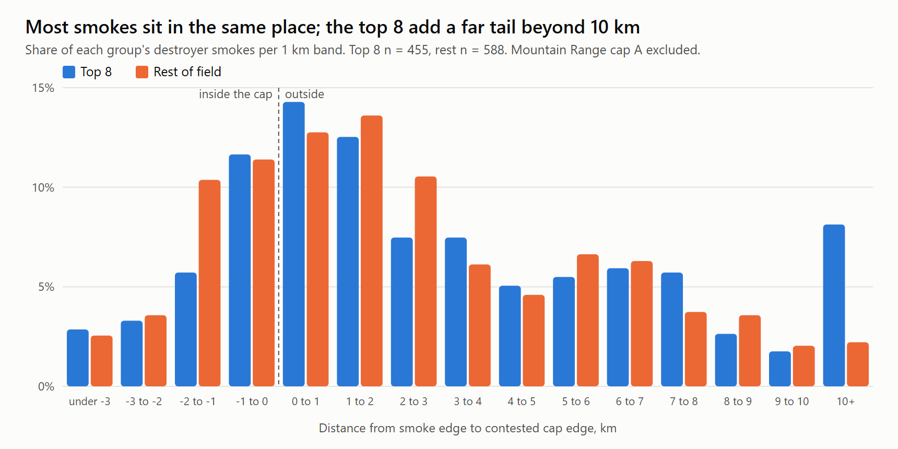
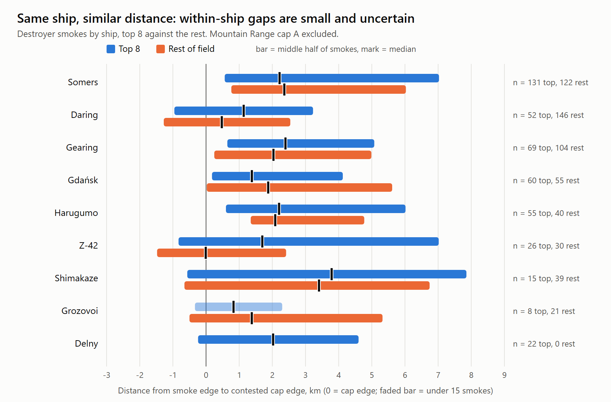
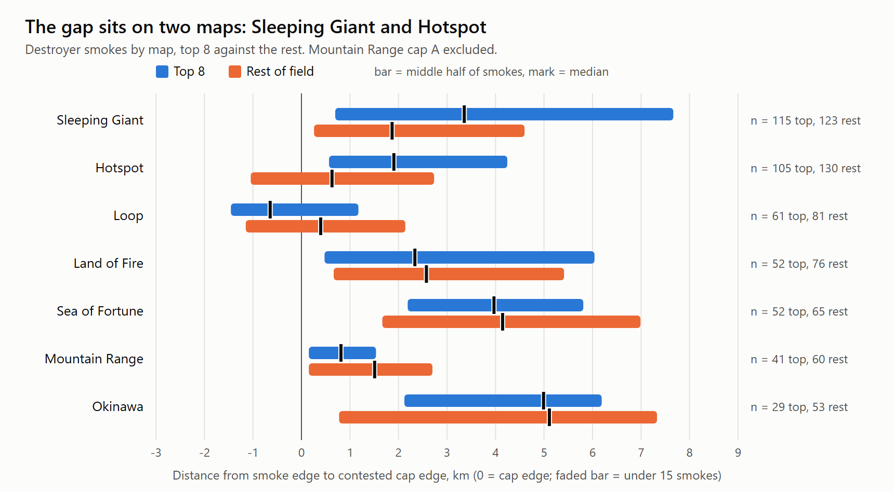
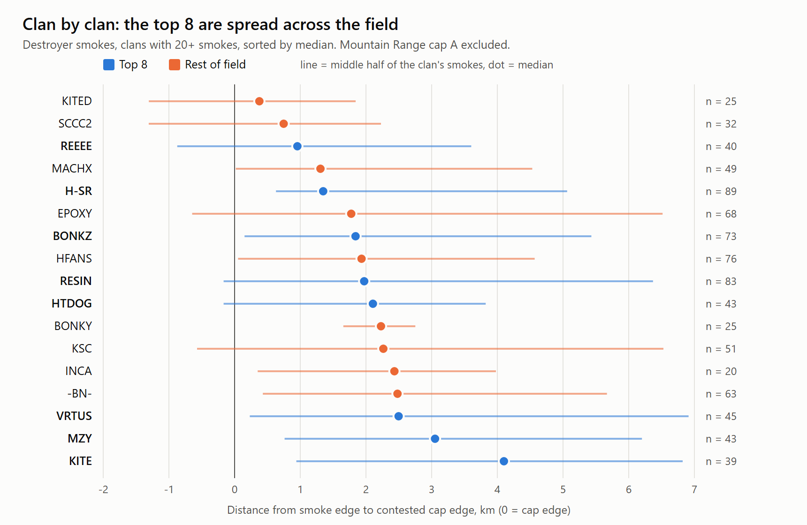
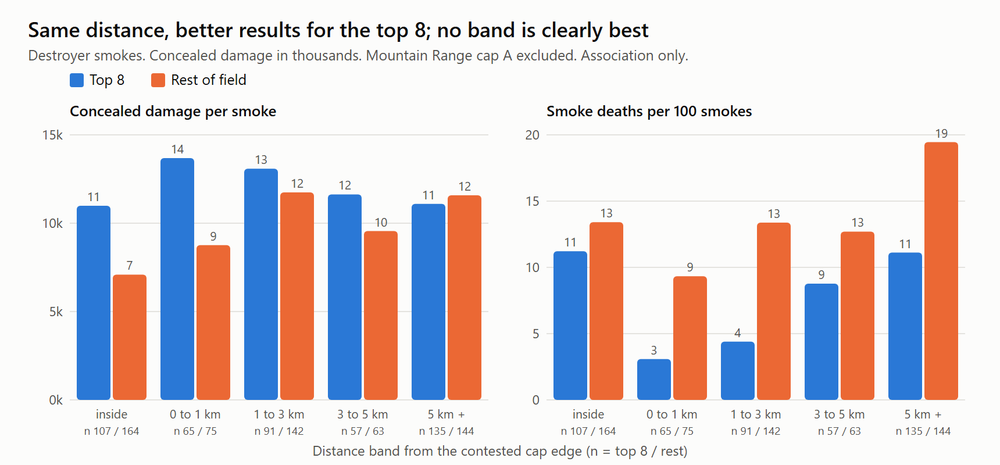
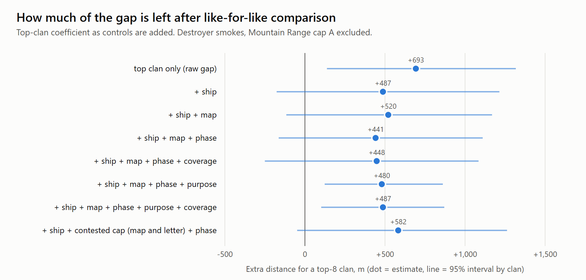

# Why top-clan destroyers smoke further from the contested cap

Follow-up to TOP-CLANS.md. Read-only; reproduce with
`python -I -X utf8 smoke/analysis/cap_distance.py output/20261117-122135` (about 2 minutes). Every table the script prints is in `cap-distance/tables-full.md`.

**Batch.** `output/20261117-122135`, the batch behind the site published 17 Nov 2026 at 12:46 EST (STEP7-REVIEW2.md): 1,547 smokes, 171 games. TOP-CLANS.md used the earlier `20261116-214739`; the cap distance numbers are the same in both (2,904 vs 2,297 m). Concealed damage in this batch includes torpedoes launched from smoke (39 destroyer smokes have any).

## Definitions

- **Distance to the contested cap edge** (`avg_contested_cap_dist_m`, the published field). Every 2 seconds while the smoke stands, the tool takes the puff nearest each contested cap and measures puff centre to cap centre, minus the smoke radius, minus the cap radius. It keeps the nearest contested cap at that moment and averages over the smoke's life. So it is smoke edge to cap edge; negative means the smoke reaches inside the cap.
- **Distance to the cap centre.** Derived from the published depth field: cap radius x (1 - `contested_cap_depth_pct` / 100). This is smoke edge to cap centre for the named contested cap.
- **Distance to the nearest cap of any status.** Computed here from the laid path and the cap positions in each `game.json`: nearest puff to each cap, edge to edge, smallest value. It uses the whole path at once, not 2-second samples, so it is close to but not the same method as the published field. The nearest cap is the contested cap for 85% of destroyer smokes.
- **How the contested cap is chosen.** A cap is contested for a team when (a) the midline between the two spawns crosses it, (b) it lies wholly on the enemy's side of the midline, or (c) the enemy owns it. The named cap is the contested cap that was nearest most often. Destroyer smokes: 841 midline, 196 enemy side, 37 enemy owned.
- **When no cap is contested** the fields are empty. That never happens in this batch (0 of 1,547), because every map has a cap on the midline, which is always contested.
- **Mountain Range cap A** has a 9,999.99 m radius in the data (DESIGN.md records it as a real 10 km cap at the map edge). 63 smokes are tied to it, 31 of them destroyers (19 top, 12 rest), and most read as "inside". The headline is shown with and without; every other table excludes those 31.
- **Groups.** Top 8 by win % with 7+ games (H-SR, RESIN, HTDOG, KITE, VRTUS, MZY, BONKZ, REEEE) against everyone else. Destroyer smokes only: 474 top, 600 rest (455 and 588 without cap A). Intervals are 95%, from resampling whole clans. A star marks an interval that excludes zero.

## Findings

**1. The gap is a far tail, not a shift.** The mean gap is +607 m (+693 m without cap A, CI +98 to +1,282), but the median gap is only +266 m and its interval crosses zero (-311 to +911). Both groups put about the same share of smokes in or near the cap (within 1 km: 38% top, 41% rest). What differs is smokes 10 km or more from any contested cap: 37 of 455 for the top 8 (8.1%) against 13 of 588 (2.2%). Drop those 50 smokes and the gap is +135 m (CI -316 to +666). The gap is the same size measured to the cap centre (+713) or to the nearest cap of any status (+611), so it is not an artefact of the definition.
*For a player:* nothing actionable about cap play. Top clans contest caps from the same distance as everyone else; they also lay some smokes that have nothing to do with a cap.

**2. About a third is ship mix; the rest is not clearly there within a ship.** Of the +693 m, +220 m comes from which ships are used and +473 m from the same ship smoking further out (CI -262 to +1,135, crosses zero). The mix part is mostly Daring and Somers: Daring smokes sit closest (median 477 m for the rest) and are 25% of the rest's destroyer smokes but 11% of the top 8's; Somers smokes sit furthest and are 29% against 21%. Within a ship the top 8 are further in 6 of 8 ships, by 236 to 545 m for Somers, Daring, Gearing and Harugumo, while Gdańsk is 299 m closer; no single ship's gap excludes zero. With ship, map and phase held equal the top-clan effect is +441 m (CI -164 to +1,110), 64% of the raw gap.
*For a player:* nothing actionable. Picking a Somers over a Daring moves the number; it does not show a better way to play either ship.

**3. What is left sits on two maps and in selfish smokes.** Sleeping Giant +1,701 m (CI +207 to +2,899; 115 vs 123 smokes) and Hotspot +1,326 m (CI +344 to +2,400; 105 vs 130). The other five maps are within about 500 m either way with intervals crossing zero. 17 of the top 8's 37 far-tail smokes are on Sleeping Giant, where their Somers smokes have a median of 7,243 m against 2,999 m (35 vs 40 smokes). By coverage, the gap is in selfish smokes (+1,796 m, CI +309 to +3,176) and absent in stacked ones (+63 m). Destroyer smokes stacked on a cruiser sit at the same distance in both groups (median 2,316 vs 2,314 m; 177 vs 190), so stacking for cruisers does not explain the gap. The gap is also larger when the enemy holds the cap (+1,087 m) and when ahead on score (+978 m), and near zero when the score is level (+181 m).
*For a player:* worth a look on the Sleeping Giant map page (top-8 Somers smokes, 4 minutes onward) to see what those far smokes are covering. The data shows where, not why.

**4. It is not one clan.** Leaving out any one top clan keeps the mean gap between +605 m (without KITE, CI -0 to +1,150) and +850 m (without REEEE). Without H-SR it is +714 m; H-SR's own median (1,349 m) is below the rest-of-field median (1,701 m). Six of the 8 top clans have a median above the rest's, and every one of them has at least one far-tail smoke. The median gap never excludes zero, with or without any clan.
*For a player:* nothing actionable; this only says the pattern is shared across the top 8 and is modest.

**5. Distance does not predict results; the top 8 do better at every distance.** Within a ship, distance has almost no rank correlation with concealed damage (-0.18 to +0.30 across ship and group, most near zero) and no distance band is best across ships. At the same distance the top 8 get more out of a smoke: 0 to 1 km from the cap, 13,684 concealed damage and 3.1 deaths per 100 smokes against 8,759 and 9.3 (65 vs 75 smokes); 1 to 3 km, the cap was won during 41% of their smokes against 19% (91 vs 142). The one band where they do not lead on damage is the far tail itself (5 km +: 11,093 vs 11,578). For Gearing and Harugumo, smokes reaching inside the cap carry the most deaths (38 and 33 per 100; 34 and 18 smokes) along with the most kills.
*For a player:* do not copy the distance. The same spot gives the top 8 better results, which points at what happens around the smoke (support, timing, opposition), not where it is laid.

## Association versus cause

- Nothing here shows that smoking further out helps a clan win. Top clans are ahead more often, face enemy-held caps differently and bring different ships; each of those moves distance on its own.
- Only 8 clans are in the top group. Most intervals are wide, and many splits were tried: expect a few starred rows by chance.
- The model with purpose has a tighter interval (+480 m, CI +123 to +861), but the cap contest purpose is defined by being within 1 km of the cap, so that control uses the outcome to explain itself. The ship + map + phase row is the fair one.
- Outcome rows (damage, deaths, caps won) follow winning as well as skill; see TOP-CLANS.md.

## Supporting tables

Destroyer smokes, Mountain Range cap A excluded unless a row says otherwise. Distances in metres from smoke edge to contested cap edge. "Small n" marks cells under 15 smokes in either group.

### Headline gap under each definition (destroyer smokes)

| Measure | Smokes | n top / rest | Mean top | Mean rest | Mean gap | 95% CI | Median top | Median rest | Median gap | 95% CI |
|---|---|---|---|---|---|---|---|---|---|---|
| Edge of contested cap (the published field) | all | 474 / 600 | 2,904 | 2,297 | +607 | +93 to +1,179 * | 1,855 | 1,674 | +181 | -320 to +829 |
| Edge of contested cap (the published field) | without Mountain Range cap A | 455 / 588 | 3,073 | 2,380 | +693 | +98 to +1,282 * | 1,967 | 1,701 | +266 | -311 to +911 |
| Centre of contested cap | all | 474 / 600 | 6,748 | 5,992 | +756 | +241 to +1,321 * | 5,745 | 5,337 | +408 | -189 to +1,202 |
| Centre of contested cap | without Mountain Range cap A | 455 / 588 | 6,660 | 5,946 | +713 | +171 to +1,339 * | 5,653 | 5,298 | +355 | -237 to +1,118 |
| Edge of nearest cap, any status | all | 474 / 600 | 1,963 | 1,352 | +611 | +121 to +1,178 * | 1,199 | 968 | +231 | -228 to +832 |
| Edge of nearest cap, any status | cap A ignored as a cap | 474 / 600 | 2,384 | 1,550 | +834 | +278 to +1,389 * | 1,399 | 1,019 | +380 | -130 to +1,001 |

### Distribution, destroyer smokes, edge of contested cap

| Smokes | Group | n | Mean | Q1 | Median | Q3 | Inside | Within 1 km | Beyond 5 km |
|---|---|---|---|---|---|---|---|---|---|
| All | Top 8 | 474 | 2,904 | 45 | 1,855 | 5,505 | 25% | 39% | 29% |
| All | Rest | 600 | 2,297 | -373 | 1,674 | 4,751 | 29% | 41% | 24% |
| Without Mountain Range cap A | Top 8 | 455 | 3,073 | 159 | 1,967 | 5,812 | 24% | 38% | 30% |
| Without Mountain Range cap A | Rest | 588 | 2,380 | -310 | 1,701 | 4,884 | 28% | 41% | 24% |
| Mountain Range cap A only | Top 8 | 19 | -1,137 | -3,639 | -1,352 | 1,337 | 58% | 68% | 5% |
| Mountain Range cap A only | Rest | 12 | -1,776 | -4,608 | -2,335 | 720 | 67% | 75% | 8% |

### 1. By ship

| Level | Group | n | Mean | Q1 | Median | Q3 | Inside | Within 1 km | Beyond 5 km | Mean gap (top - rest) | 95% CI (by clan) |
|---|---|---|---|---|---|---|---|---|---|---|---|
| Somers | Top 8 | 131 | 3,792 | 563 | 2,218 | 7,025 | 19% | 36% | 39% | +545 | -791 to +1,973 |
| | Rest | 122 | 3,247 | 764 | 2,361 | 6,029 | 14% | 30% | 31% | | |
| Daring | Top 8 | 52 | 1,517 | -956 | 1,135 | 3,227 | 38% | 48% | 15% | +486 | -1,019 to +2,030 |
| | Rest | 146 | 1,031 | -1,276 | 477 | 2,541 | 44% | 58% | 12% | | |
| Gearing | Top 8 | 69 | 2,953 | 642 | 2,396 | 5,074 | 14% | 32% | 26% | +236 | -878 to +1,327 |
| | Rest | 104 | 2,717 | 248 | 2,034 | 4,986 | 23% | 34% | 25% | | |
| Gdańsk | Top 8 | 60 | 2,537 | 180 | 1,382 | 4,125 | 23% | 43% | 23% | -299 | -1,788 to +1,194 |
| | Rest | 55 | 2,836 | 22 | 1,874 | 5,615 | 25% | 42% | 29% | | |
| Harugumo | Top 8 | 55 | 3,357 | 601 | 2,203 | 6,017 | 22% | 31% | 33% | +449 | -619 to +1,907 |
| | Rest | 40 | 2,907 | 1,348 | 2,086 | 4,771 | 15% | 20% | 25% | | |
| Z-42 | Top 8 | 26 | 3,549 | -829 | 1,696 | 7,019 | 35% | 46% | 38% | +2,697 | -1,547 to +5,317 |
| | Rest | 30 | 852 | -1,477 | -9 | 2,414 | 50% | 63% | 20% | | |
| Shimakaze | Top 8 | 15 | 4,587 | -566 | 3,789 | 7,854 | 33% | 33% | 40% | +1,131 | -1,548 to +3,537 |
| | Rest | 39 | 3,456 | -652 | 3,407 | 6,743 | 28% | 33% | 36% | | |
| Grozovoi (small n) | Top 8 | 8 | 1,769 | -334 | 830 | 2,298 | 25% | 62% | 12% | -898 | -2,508 to +3,143 |
| | Rest | 21 | 2,667 | -500 | 1,381 | 5,322 | 33% | 43% | 29% | | |
| Delny (small n) | Top 8 | 22 | 2,404 | -240 | 2,023 | 4,601 | 27% | 36% | 23% | - | - |
| | Rest | 0 | - | - | - | - | - | - | - | | |
| other | Top 8 | 17 | 3,163 | 285 | 2,497 | 4,942 | 24% | 29% | 24% | +530 | -2,715 to +3,228 |
| | Rest | 31 | 2,633 | 156 | 2,173 | 5,469 | 19% | 39% | 32% | | |

Ship mix (share of group destroyer smokes) and smoke radius:

| Ship | Top 8 | Rest | Smoke radius m | Emission s |
|---|---|---|---|---|
| Somers | 28.8% | 20.7% | 450 | 30 |
| Daring | 11.4% | 24.8% | 600 | 10 |
| Gearing | 15.2% | 17.7% | 450 | 30 |
| Gdańsk | 13.2% | 9.4% | 450 | 20 |
| Harugumo | 12.1% | 6.8% | 450 | 20 |
| Z-42 | 5.7% | 5.1% | 600 | 10 |
| Shimakaze | 3.3% | 6.6% | 450 | 20 |
| Grozovoi | 1.8% | 3.6% | 450 | 20 |
| Delny | 4.8% | 0.0% | 450 | 30 |
| other | 3.7% | 5.3% | 450 | 30 |

Decomposition of the mean gap (mix = different shares of each level; within = same level, different distance):

| Split by | Smokes | Total gap | Mix part | 95% CI | Within part | 95% CI |
|---|---|---|---|---|---|---|
| ship | without cap A | +693 | +220 | -114 to +659 | +473 | -262 to +1,135 |
| ship | all | +607 | +195 | -90 to +615 | +412 | -295 to +1,073 |
| map | without cap A | +693 | -2 | -272 to +250 | +695 | +192 to +1,234 * |
| ship x map | without cap A | +693 | +118 | -333 to +686 | +575 | -129 to +1,162 |
| phase | without cap A | +693 | +2 | -40 to +69 | +691 | +114 to +1,237 * |
| coverage | without cap A | +693 | +25 | -57 to +142 | +668 | +78 to +1,353 * |
| primary purpose | without cap A | +693 | +157 | -175 to +551 | +536 | +173 to +866 * |

### 2. By map

| Level | Group | n | Mean | Q1 | Median | Q3 | Inside | Within 1 km | Beyond 5 km | Mean gap (top - rest) | 95% CI (by clan) |
|---|---|---|---|---|---|---|---|---|---|---|---|
| Sleeping Giant | Top 8 | 115 | 4,280 | 696 | 3,356 | 7,665 | 20% | 28% | 41% | +1,701 | +207 to +2,899 * |
| | Rest | 123 | 2,579 | 259 | 1,868 | 4,599 | 21% | 37% | 23% | | |
| Hotspot | Top 8 | 105 | 2,843 | 567 | 1,904 | 4,243 | 18% | 36% | 25% | +1,326 | +344 to +2,400 * |
| | Rest | 130 | 1,517 | -1,045 | 631 | 2,736 | 39% | 53% | 20% | | |
| Loop | Top 8 | 61 | 422 | -1,455 | -644 | 1,175 | 56% | 74% | 11% | -172 | -1,108 to +793 |
| | Rest | 81 | 594 | -1,148 | 395 | 2,142 | 43% | 59% | 7% | | |
| Land of Fire | Top 8 | 52 | 3,574 | 476 | 2,338 | 6,041 | 17% | 33% | 37% | +528 | -1,202 to +2,516 |
| | Rest | 76 | 3,046 | 665 | 2,576 | 5,414 | 21% | 28% | 28% | | |
| Sea of Fortune | Top 8 | 52 | 3,895 | 2,190 | 3,968 | 5,809 | 21% | 21% | 35% | -260 | -1,683 to +1,389 |
| | Rest | 65 | 4,154 | 1,667 | 4,147 | 6,988 | 20% | 23% | 45% | | |
| Mountain Range | Top 8 | 41 | 1,468 | 151 | 814 | 1,536 | 20% | 61% | 10% | -394 | -2,087 to +1,005 |
| | Rest | 60 | 1,862 | 153 | 1,509 | 2,701 | 23% | 43% | 12% | | |
| Okinawa | Top 8 | 29 | 4,589 | 2,122 | 4,991 | 6,189 | 10% | 14% | 48% | +369 | -1,498 to +2,594 |
| | Rest | 53 | 4,220 | 776 | 5,111 | 7,329 | 17% | 26% | 51% | | |

### 3. By phase (minutes elapsed)

| Level | Group | n | Mean | Q1 | Median | Q3 | Inside | Within 1 km | Beyond 5 km | Mean gap (top - rest) | 95% CI (by clan) |
|---|---|---|---|---|---|---|---|---|---|---|---|
| 0 to 4 | Top 8 | 96 | 2,051 | 690 | 1,486 | 2,489 | 16% | 38% | 11% | +214 | -460 to +957 |
| | Rest | 123 | 1,837 | 27 | 1,449 | 2,781 | 25% | 41% | 14% | | |
| 4 to 8 | Top 8 | 153 | 3,225 | 222 | 2,364 | 6,050 | 22% | 35% | 33% | +729 | +78 to +1,404 * |
| | Rest | 226 | 2,496 | -285 | 1,885 | 5,460 | 30% | 43% | 27% | | |
| 8 to 12 | Top 8 | 143 | 3,423 | -336 | 2,517 | 6,708 | 28% | 38% | 35% | +724 | -312 to +1,817 |
| | Rest | 172 | 2,700 | -327 | 1,816 | 5,612 | 27% | 38% | 29% | | |
| 12+ | Top 8 | 63 | 3,464 | -541 | 2,771 | 6,988 | 29% | 44% | 37% | +1,299 | -202 to +2,614 |
| | Rest | 67 | 2,165 | -693 | 2,175 | 4,509 | 30% | 39% | 22% | | |

### 4b. By coverage

| Level | Group | n | Mean | Q1 | Median | Q3 | Inside | Within 1 km | Beyond 5 km | Mean gap (top - rest) | 95% CI (by clan) |
|---|---|---|---|---|---|---|---|---|---|---|---|
| stacked | Top 8 | 191 | 3,197 | 482 | 2,278 | 5,639 | 18% | 34% | 30% | +63 | -936 to +970 |
| | Rest | 205 | 3,134 | 406 | 2,379 | 6,050 | 21% | 31% | 33% | | |
| screen | Top 8 | 154 | 2,497 | -318 | 1,287 | 4,979 | 27% | 42% | 25% | +416 | -304 to +1,327 |
| | Rest | 195 | 2,081 | -321 | 1,556 | 4,053 | 26% | 44% | 22% | | |
| selfish | Top 8 | 110 | 3,663 | -377 | 2,206 | 7,054 | 28% | 39% | 35% | +1,796 | +309 to +3,176 * |
| | Rest | 188 | 1,867 | -850 | 1,117 | 3,573 | 37% | 48% | 18% | | |

### 4c. Stacked destroyer smokes by class of the ally they were laid beside

| Level | Group | n | Mean | Q1 | Median | Q3 | Inside | Within 1 km | Beyond 5 km | Mean gap (top - rest) |
|---|---|---|---|---|---|---|---|---|---|---|
| Cruiser | Top 8 | 177 | 3,274 | 482 | 2,316 | 5,819 | 17% | 33% | 31% | +182 |
| | Rest | 190 | 3,091 | 398 | 2,314 | 6,153 | 21% | 32% | 32% | |
| Battleship (small n) | Top 8 | 13 | 2,272 | -1,455 | 1,964 | 4,201 | 31% | 38% | 23% | -1,244 |
| | Rest | 14 | 3,515 | 1,149 | 2,677 | 5,934 | 21% | 21% | 36% | |
| unknown (small n) | Top 8 | 1 | 1,623 | 1,623 | 1,623 | 1,623 | 0% | 0% | 0% | -4,306 |
| | Rest | 1 | 5,929 | 5,929 | 5,929 | 5,929 | 0% | 0% | 100% | |

Stacked share of destroyer smokes: top 42.0% rest 34.9%

### 5a. By score at activation

| Level | Group | n | Mean | Q1 | Median | Q3 | Inside | Within 1 km | Beyond 5 km | Mean gap (top - rest) | 95% CI (by clan) |
|---|---|---|---|---|---|---|---|---|---|---|---|
| ahead (50+) | Top 8 | 192 | 3,449 | -189 | 2,895 | 6,640 | 26% | 38% | 36% | +978 | +229 to +1,920 * |
| | Rest | 169 | 2,470 | -500 | 1,667 | 5,616 | 30% | 43% | 30% | | |
| level | Top 8 | 187 | 2,338 | 602 | 1,544 | 3,678 | 20% | 38% | 19% | +181 | -440 to +824 |
| | Rest | 225 | 2,157 | -228 | 1,544 | 3,850 | 29% | 43% | 19% | | |
| behind (50+) | Top 8 | 76 | 3,931 | -355 | 3,407 | 7,200 | 28% | 37% | 41% | +1,371 | -401 to +3,270 |
| | Rest | 194 | 2,560 | 20 | 2,031 | 5,082 | 25% | 37% | 26% | | |

### 5b. By owner of the contested cap at activation

| Level | Group | n | Mean | Q1 | Median | Q3 | Inside | Within 1 km | Beyond 5 km | Mean gap (top - rest) | 95% CI (by clan) |
|---|---|---|---|---|---|---|---|---|---|---|---|
| ours | Top 8 | 166 | 1,913 | -812 | 772 | 4,022 | 38% | 54% | 21% | +821 | +175 to +1,696 * |
| | Rest | 193 | 1,092 | -1,360 | 429 | 2,925 | 42% | 56% | 16% | | |
| neutral | Top 8 | 121 | 2,039 | 642 | 1,349 | 2,586 | 15% | 39% | 13% | +627 | +7 to +1,325 * |
| | Rest | 139 | 1,412 | -399 | 1,081 | 2,397 | 31% | 47% | 9% | | |
| theirs | Top 8 | 168 | 4,963 | 1,705 | 5,000 | 7,817 | 15% | 21% | 50% | +1,087 | +8 to +1,976 * |
| | Rest | 256 | 3,876 | 965 | 3,596 | 6,517 | 15% | 26% | 39% | | |

### 6. By clan

| Clan | Group | Games | n | Mean | Q1 | Median | Q3 | Inside | Within 1 km | Beyond 5 km | Top ship |
|---|---|---|---|---|---|---|---|---|---|---|---|
| KITE | Top 8 | 14 | 39 | 4,008 | 940 | 4,101 | 6,822 | 18% | 26% | 44% | Gearing (19) |
| MZY | Top 8 | 19 | 43 | 3,637 | 761 | 3,051 | 6,201 | 21% | 28% | 35% | Somers (22) |
| VRTUS | Top 8 | 11 | 45 | 3,471 | 231 | 2,497 | 6,911 | 22% | 36% | 31% | Z-42 (14) |
| HTDOG | Top 8 | 18 | 43 | 2,463 | -167 | 2,106 | 3,822 | 28% | 37% | 21% | Daring (19) |
| RESIN | Top 8 | 24 | 83 | 3,285 | -167 | 1,974 | 6,370 | 27% | 40% | 35% | Somers (38) |
| BONKZ | Top 8 | 21 | 73 | 3,112 | 151 | 1,841 | 5,431 | 23% | 40% | 27% | Gearing (37) |
| H-SR | Top 8 | 22 | 89 | 2,987 | 631 | 1,349 | 5,064 | 16% | 40% | 27% | Somers (33) |
| REEEE | Top 8 | 13 | 40 | 1,439 | -873 | 956 | 3,603 | 40% | 50% | 18% | Somers (21) |
| -BN- | Rest | 14 | 63 | 3,146 | 431 | 2,480 | 5,669 | 14% | 30% | 35% | Daring (22) |
| INCA | Rest | 6 | 20 | 2,653 | 351 | 2,432 | 3,978 | 15% | 45% | 20% | Gearing (7) |
| KSC | Rest | 11 | 51 | 3,288 | -571 | 2,264 | 6,528 | 31% | 33% | 35% | Gearing (29) |
| BONKY | Rest | 7 | 25 | 2,620 | 1,655 | 2,229 | 2,751 | 8% | 16% | 16% | Somers (14) |
| HFANS | Rest | 17 | 76 | 2,562 | 53 | 1,933 | 4,568 | 25% | 41% | 24% | Somers (28) |
| EPOXY | Rest | 17 | 68 | 3,020 | -646 | 1,776 | 6,515 | 34% | 38% | 35% | Somers (18) |
| MACHX | Rest | 14 | 49 | 2,369 | 19 | 1,307 | 4,531 | 24% | 41% | 22% | Somers (17) |
| SCCC2 | Rest | 7 | 32 | 1,130 | -1,308 | 747 | 2,228 | 38% | 56% | 9% | Daring (26) |
| KITED | Rest | 14 | 25 | 828 | -1,306 | 378 | 1,842 | 44% | 56% | 16% | Daring (16) |

Rest clans with fewer than 20 destroyer smokes are not listed (13 clans).
Top-8 clans with a median above the rest-of-field median (1,701 m): 6 of 8; above the rest mean (2,380 m) on their mean: 7 of 8

Leave one top clan out:

| Left out | n top | Mean gap | 95% CI | Median gap | 95% CI | Mean gap, all smokes incl. cap A |
|---|---|---|---|---|---|---|
| (none) | 455 | +693 | +153 to +1,267 * | +266 | -285 to +969 | +607 |
| BONKZ | 382 | +685 | +45 to +1,346 * | +305 | -274 to +1,062 | +642 |
| H-SR | 366 | +714 | +7 to +1,362 * | +413 | -207 to +1,177 | +588 |
| HTDOG | 412 | +756 | +267 to +1,347 * | +245 | -363 to +1,063 | +667 |
| KITE | 416 | +605 | -0 to +1,150 | +178 | -416 to +796 | +549 |
| MZY | 412 | +634 | +31 to +1,283 * | +154 | -459 to +898 | +534 |
| REEEE | 415 | +850 | +408 to +1,407 * | +448 | -42 to +1,083 | +743 |
| RESIN | 372 | +646 | +1 to +1,281 * | +216 | -407 to +1,003 | +575 |
| VRTUS | 410 | +649 | +39 to +1,256 * | +213 | -340 to +893 | +559 |

### 7a. Outcomes by distance band, all destroyers

| Band | Group | n | Concealed dmg per smoke | Median | Any concealed dmg | Deaths per 100 | Kills per 100 | Cap won | Cap defended |
|---|---|---|---|---|---|---|---|---|---|
| inside | Top 8 | 107 | 10,984 | 3,927 | 70% | 11.2 | 17.8 | 27% | 35% |
|  | Rest | 164 | 7,094 | 1,355 | 60% | 13.4 | 9.8 | 24% | 39% |
| 0 to 1 km | Top 8 | 65 | 13,684 | 8,749 | 78% | 3.1 | 7.7 | 38% | 49% |
|  | Rest | 75 | 8,759 | 2,390 | 72% | 9.3 | 4.0 | 33% | 32% |
| 1 to 3 km | Top 8 | 91 | 13,086 | 6,426 | 78% | 4.4 | 6.6 | 41% | 26% |
|  | Rest | 142 | 11,745 | 3,365 | 65% | 13.4 | 7.7 | 19% | 34% |
| 3 to 5 km | Top 8 | 57 | 11,629 | 7,615 | 77% | 8.8 | 7.0 | 21% | 28% |
|  | Rest | 63 | 9,555 | 2,716 | 59% | 12.7 | 6.3 | 5% | 30% |
| 5 km + | Top 8 | 135 | 11,093 | 4,965 | 76% | 11.1 | 13.3 | 12% | 23% |
|  | Rest | 144 | 11,578 | 3,722 | 72% | 19.4 | 11.1 | 13% | 36% |

Rank correlation of distance with concealed damage and with smoke deaths, within ship:

| Ship | Group | n | Distance vs concealed damage | Distance vs smoke deaths |
|---|---|---|---|---|
| Somers | Top 8 | 131 | -0.07 | -0.01 |
| Somers | Rest | 122 | -0.11 | +0.09 |
| Daring | Top 8 | 52 | +0.09 | +0.27 |
| Daring | Rest | 146 | +0.10 | +0.08 |
| Gearing | Top 8 | 69 | -0.18 | -0.30 |
| Gearing | Rest | 104 | -0.01 | -0.16 |
| Gdańsk | Top 8 | 60 | +0.06 | -0.08 |
| Gdańsk | Rest | 55 | +0.30 | +0.13 |
| Harugumo | Top 8 | 55 | -0.03 | +0.11 |
| Harugumo | Rest | 40 | -0.14 | +0.05 |
| Z-42 | Top 8 | 26 | +0.18 | +0.00 |
| Z-42 | Rest | 30 | +0.05 | -0.14 |
| Shimakaze | Top 8 | 15 | -0.07 | +0.16 |
| Shimakaze | Rest | 39 | +0.12 | +0.04 |
| Grozovoi | Rest | 21 | -0.22 | +0.00 |
| Delny | Top 8 | 22 | +0.24 | +0.00 |
| other | Top 8 | 17 | -0.25 | +0.19 |
| other | Rest | 31 | +0.20 | +0.10 |
| ALL | Top 8 | 455 | +0.02 | +0.02 |
| ALL | Rest | 588 | +0.11 | +0.05 |

### 8. Model: distance to contested cap edge, without Mountain Range cap A (n = 1043)

| Model | Terms | Top-clan coefficient, m | 95% CI (by clan) | Share of raw gap kept |
|---|---|---|---|---|
| top clan only (raw gap) | 2 | +693 | +138 to +1,317 * | 100% |
| + ship | 11 | +487 | -177 to +1,214 | 70% |
| + ship + map | 17 | +520 | -116 to +1,169 | 75% |
| + ship + map + phase | 20 | +441 | -164 to +1,110 | 64% |
| + ship + map + phase + coverage | 22 | +448 | -250 to +1,084 | 65% |
| + ship + map + phase + purpose | 29 | +480 | +123 to +861 * | 69% |
| + ship + map + phase + purpose + coverage | 31 | +487 | +102 to +870 * | 70% |
| + ship + contested cap (map and letter) + phase | 38 | +582 | -49 to +1,262 | 84% |
