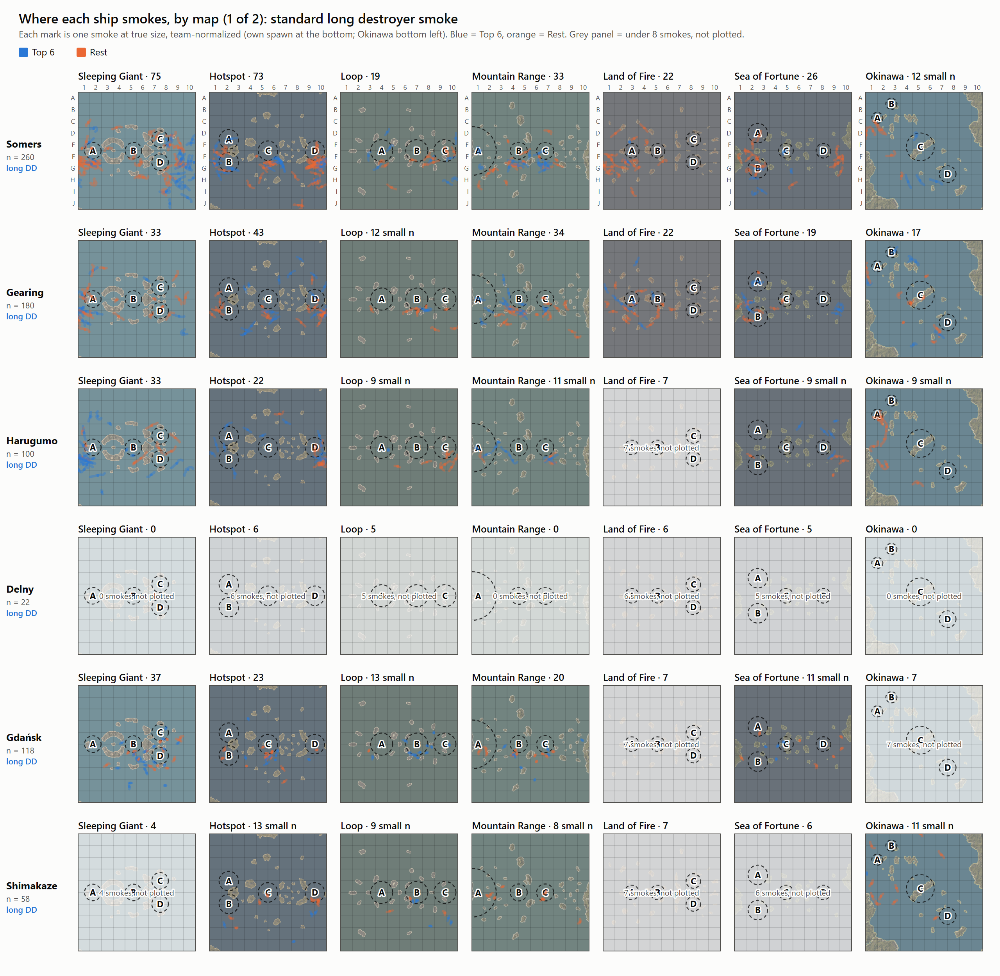
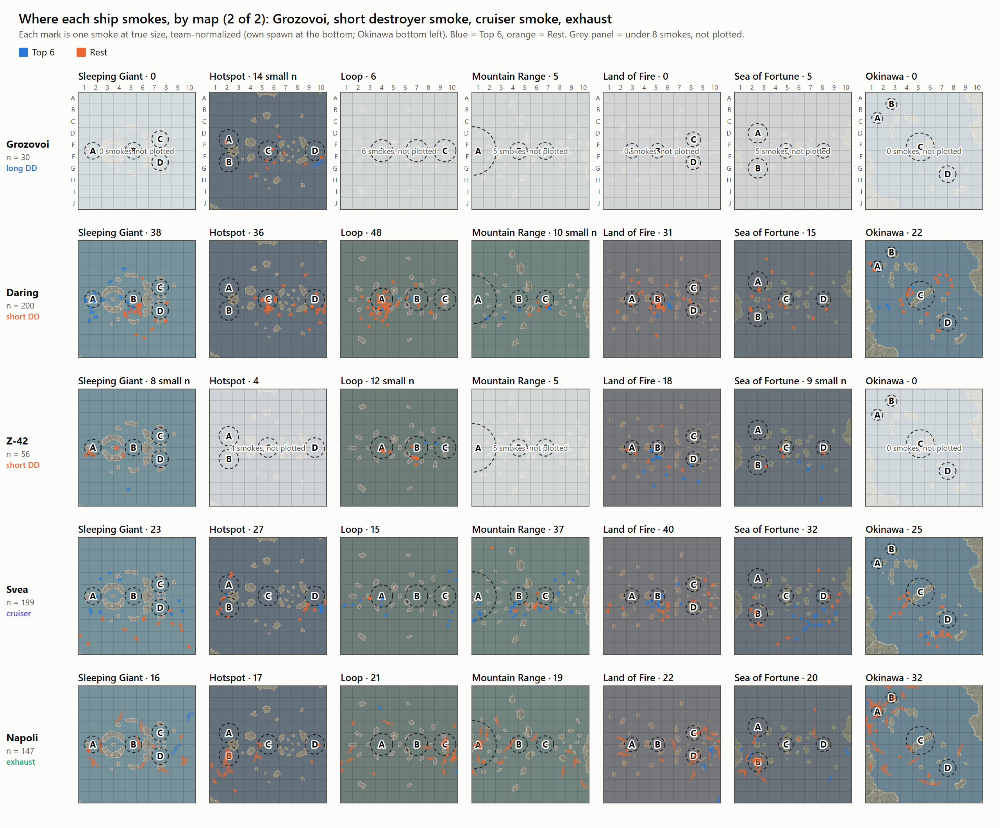
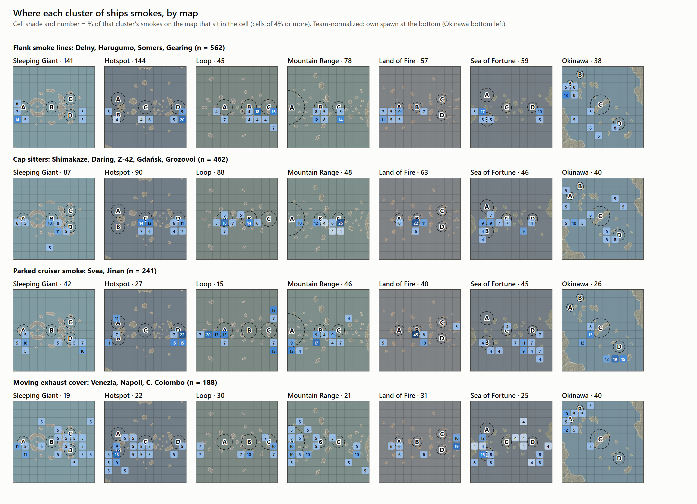
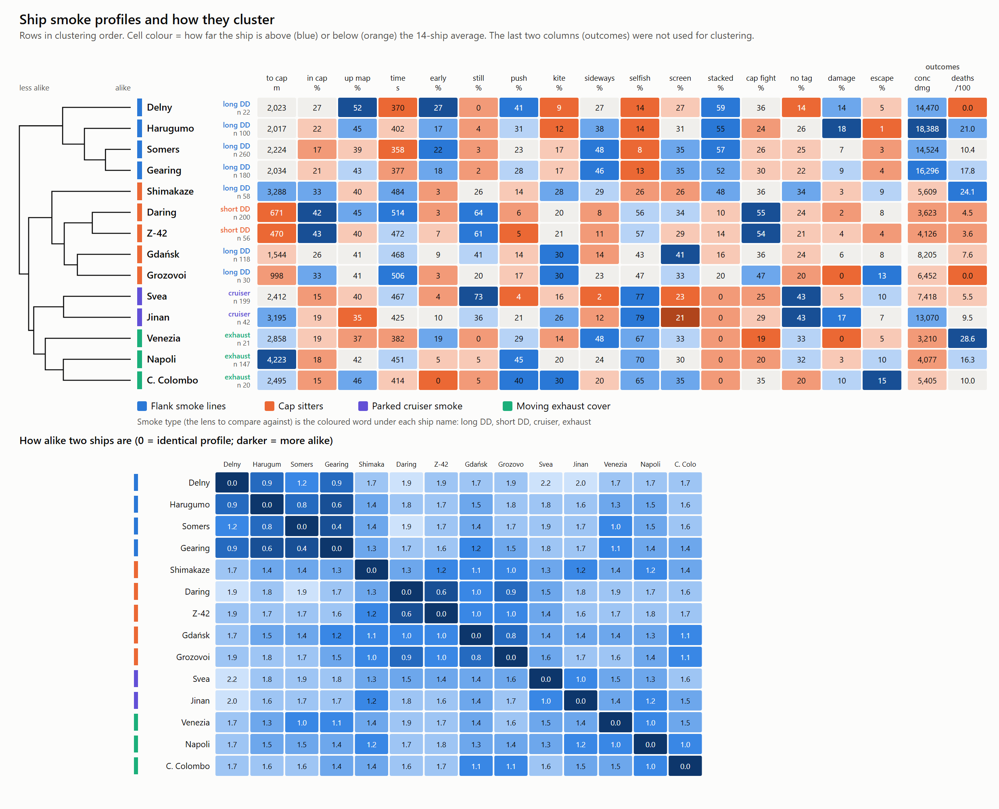
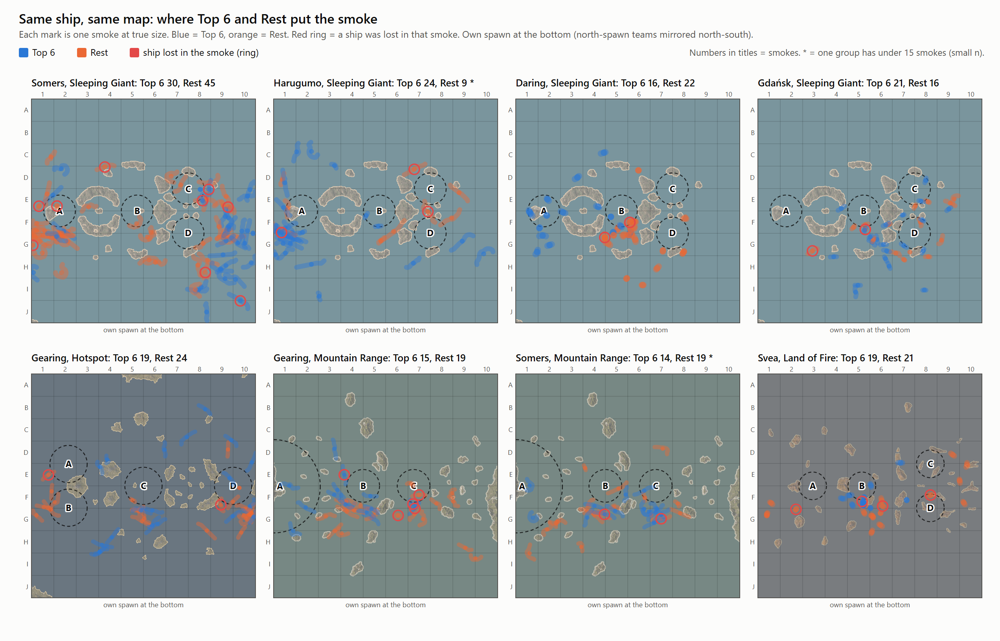

# Module 1: where each ship smokes

Batch `output/20261117-122135` (1,547 smokes, 171 games). Ships covered: the nine named destroyers plus every other ship with 20 or more smokes (Svea, Jinan, Napoli, Venezia, C. Colombo).

**How to read the maps.** Positions are team-normalized: the smoking team's spawn is always at the bottom. North-spawn teams are mirrored north-south; on Okinawa (spawns NE and SW) they are mirrored across the NW-SE diagonal, so own spawn is bottom left. East and west are never swapped (except on Okinawa). Intervals are 95%, made by resampling whole clans. `*` means the interval excludes zero. **Everything here is association, not cause.**

## Findings

**1. Ships fall into four smoke habits, and the habit is not the same thing as the smoke type.** (Figure 3)
Clustering on 16 behaviour measures gives four groups that are stable when outcomes are added and when only destroyers are used:

| Cluster | Ships | n | What they do |
|---|---|---|---|
| Flank smoke lines | Somers, Gearing, Harugumo, Delny | 562 | Laid while moving (3% stationary), 55% stacked with other smokes, about 2.1 km outside the cap edge |
| Cap sitters | Daring, Z-42, Gdańsk, Grozovoi, Shimakaze | 462 | 50% stationary, 49% for the smoker only, 37% inside a cap, about 1.0 km from the cap edge |
| Parked cruiser smoke | Svea, Jinan | 241 | 67% stationary, 77% for the smoker only, 43% with no purpose tag, 2.4 to 3.2 km from the cap |
| Moving exhaust cover | Napoli, Venezia, C. Colombo | 188 | Laid while pushing or sideways, never stacked, furthest from the cap (Napoli 4.2 km) |

Against the smoke-type lens (long DD, short DD, cruiser, exhaust; the scouting report text is not on disk, so this is the comparison used): short DD, cruiser and exhaust each match one cluster exactly. **Long DD smoke splits in two.** Gdańsk, Grozovoi and Shimakaze have long smoke but use it like a Daring. Gdańsk against Harugumo (identical 20 s smoke): stationary 41% vs 4% (interval +28 to +44 points *), stacked 16% vs 55% (-52 to -26 *).
Per map check: of 39 ship-by-map profiles with 15 or more smokes, 35 land nearest their own cluster. The misses are Daring on Sea of Fortune (n=15) and Okinawa (n=22), Svea on Loop (n=15), Napoli on Mountain Range (n=19, pulled into the 10 km cap A, see the Mountain Range note below).
*For a player:* expect a Gdańsk, Grozovoi or Shimakaze to sit in or next to a cap like a Daring, not to lay a flank line like a Somers.

**2. Flank smoke lines sit on the map edges; cap sitters sit in the middle caps.** (Figures 1a, 1b, 2)
- Hotspot: flank lines put 20% of their smokes in cell G10 alone, and 34% in G9/G10/F10 next to cap D (n=144). Cap sitters put 40% in F5/F6/G5/G6 around cap C (n=90).
- Sleeping Giant: flank lines 14% in G1 and 32% in E1 to G2 beside cap A (n=141). Cap sitters cluster at B and D: F5/F6/G6 hold 29% (n=87).
- Loop: Daring 29% in F4 on cap A (n=48); flank lines 18% in F8 and 16% in F10 (n=45).
- Land of Fire: Daring 49% in F5/F6 on cap B (n=31); Somers 37% in G1/F1 on the west edge (n=22).
*For a player:* on Hotspot look for the long smoke line at G10 and the short smoke on C; on Sleeping Giant the line is at G1 and the short smoke at B.

**3. Flank smoke lines carry the concealed damage; cap sitters barely shoot from smoke.**
Concealed damage per smoke: 15,777 for flank lines (n=562) vs 5,287 for cap sitters (n=462), difference +10,490 (interval +8,117 to +12,309 *). By ship: Harugumo 18,388, Gearing 16,296, Somers 14,524, against Daring 3,623 and Z-42 4,126. The flank lines also lose more ships: 14.2 vs 7.4 deaths per 100 smokes (+2.2 to +11.9 *). This batch counts torpedoes launched from smoke as concealed damage.
*For a player:* the long flank line is where smoke firing happens, and it is also where smokes get punished. A Daring smoke is a cap tool, not a damage tool.

**4. On Sleeping Giant the Top 6 split their destroyers by side differently from the Rest.** (Figure 4, top row)
- Somers: Top 6 put 17% of smokes in the west half (n=30) vs 51% for Rest (n=45), difference -34 points (-65 to -6 *). Top 6 Somers smokes run down the east edge, columns 8 to 10, rows E to I.
- Daring: Top 6 94% west, around cap A (n=16, only 2 clans) vs Rest 32% (n=22), +62 points (+38 to +73 *). Top 6 are also inside a cap more: 50% vs 18% (+3 to +47 *).
- Harugumo: Top 6 88% west at G1/F1 (n=24) vs Rest 44% (n=9, small n), +43 points (-12 to +94, not settled).
*For a player:* the Top 6 pattern on Sleeping Giant is Somers east, Harugumo and Daring west at cap A. The Rest more often send the Somers west and park the Daring at B/D.

**5. Other same-ship, same-map differences.** (Figure 4, bottom row)
- Svea on Land of Fire: 74% of Top 6 smokes are in the single cell F5 on cap B (n=19) vs 19% for Rest (n=21), +55 points (+10 to +83 *). Top 6 are 0.4 km from the cap vs 3.1 km (-5,076 to -242 m *).
- Gearing on Mountain Range: Top 6 are 0.4 km from the cap edge vs 2.2 km (n=15 and 19; -3,930 to -752 m *), 33% inside vs 11% (+10 to +89 *).
- Somers on Mountain Range: Top 6 never smoke for the smoker alone (0% vs 32%, -47 to -12 *) and get 20,588 concealed damage per smoke vs 6,263 (+4,582 to +24,933 *). Top 6 n=14, small n.
- Gearing on Hotspot: Top 6 are 3.7 km out vs 1.8 km (+823 to +3,516 m *), used later (459 s vs 363 s). Only 2 Top 6 clans.
- Across all maps, within a ship, Top 6 and Rest smoke at about the same distance and time. The clear all-map gaps are Gearing smoking for the smoker alone (4% vs 20%, -30 to -4 *) and Gdańsk being used later (536 s vs 401 s, +10 to +223 *) and more often stationary (47% vs 35%, +2 to +25 *).
*For a player:* in a Svea on Land of Fire, the Top 6 spot is F5 on cap B. In a Gearing or Somers on Mountain Range, the Top 6 line is tight under B and C (rows F and G, columns 4 to 7), laid for teammates.

**6. Top 6 lose fewer ships in their smoke, but that is mostly because they win more.**
Raw gaps look large: Harugumo 9 vs 36 deaths per 100 smokes (-42.8 to -14.1 *), Gearing 10 vs 24 (-27.8 to -5.2 *), Gdańsk 3 vs 12 (-17.8 to -1.3 *). But across the nine destroyers, smokes in games won cost 4.7 (Top 6) and 4.6 (Rest) deaths per 100, no difference (-3.1 to +2.9). In games lost it is 14.9 vs 21.1 (-15.4 to +0.9).
*For a player:* nothing actionable. Deaths in smoke track losing the game, not a smoke habit.

**Mountain Range cap A (10 km cap).** These smokes are kept. They matter for Napoli (11 smokes; median distance 4.2 km with them, 5.3 km without), Jinan (9; 3.2 vs 3.8 km) and Gdańsk (3; 1.5 vs 1.8 km). No destroyer ranking above changes without them.

**PN (3-4), small n.** 10 destroyer smokes: Somers 5, Harugumo 4, Gdańsk 1. Median 3.9 km from the cap, 10% inside, 12,414 concealed damage per smoke, 3 deaths. Too few to read.

## Figures

## Supporting table: ship profiles

| Ship | Type | n | Top 6 n | Clans | To cap edge (m, median) | Inside cap | Time used (s, median) | Stationary | Smoker only | Stacked | Cap contest | Concealed dmg per smoke | Deaths per 100 |
|---|---|---|---|---|---|---|---|---|---|---|---|---|---|
| Somers | long DD | 260 | 90 | 18 | 2,224 | 17% | 358 | 3% | 8% | 57% | 26% | 14,524 | 10.4 |
| Gearing | long DD | 180 | 74 | 16 | 2,034 | 21% | 377 | 2% | 13% | 52% | 30% | 16,296 | 17.8 |
| Harugumo | long DD | 100 | 55 | 15 | 2,017 | 22% | 402 | 4% | 14% | 55% | 24% | 18,388 | 21.0 |
| Delny | long DD | 22 | 18 | 2 | 2,023 | 27% | 370 | 0% | 14% | 59% | 36% | 14,470 | 0.0 |
| Gdańsk | long DD | 118 | 60 | 16 | 1,544 | 26% | 468 | 41% | 43% | 16% | 36% | 8,205 | 7.6 |
| Shimakaze | long DD | 58 | 15 | 12 | 3,288 | 33% | 484 | 26% | 26% | 48% | 36% | 5,609 | 24.1 |
| Grozovoi | long DD | 30 | 6 | 8 | 998 | 33% | 506 | 20% | 47% | 20% | 47% | 6,452 | 0.0 |
| Daring | short DD | 200 | 34 | 20 | 671 | 42% | 514 | 64% | 56% | 10% | 55% | 3,623 | 4.5 |
| Z-42 | short DD | 56 | 20 | 8 | 470 | 43% | 472 | 61% | 57% | 14% | 54% | 4,126 | 3.6 |
| Svea | cruiser | 199 | 93 | 20 | 2,412 | 15% | 467 | 73% | 77% | 0% | 25% | 7,418 | 5.5 |
| Jinan | cruiser | 42 | 22 | 6 | 3,195 | 19% | 425 | 36% | 79% | 0% | 29% | 13,070 | 9.5 |
| Napoli | exhaust | 147 | 15 | 25 | 4,223 | 18% | 451 | 5% | 70% | 0% | 20% | 4,077 | 16.3 |
| Venezia | exhaust | 21 | 0 | 3 | 2,858 | 19% | 382 | 0% | 67% | 0% | 19% | 3,210 | 28.6 |
| C. Colombo | exhaust | 20 | 2 | 13 | 2,495 | 15% | 414 | 5% | 65% | 0% | 35% | 5,405 | 10.0 |

## Cautions

- Delny is one clan in practice (H-SR 18 of 22 smokes) and has no map with 8 or more smokes, so it is not plotted. Grozovoi is half one clan (MACHX 15 of 30). Jinan's Top 6 smokes are all from one clan, so its Top 6 vs Rest gap is not reported.
- Shimakaze is the loosest member of the cap sitters (it joins last) and its distance figure is wide (0.3 to 4.9 km).
- Z-42 Top 6 smokes come from 2 clans and sit far from the cap (4.6 km vs inside the cap for Rest, +2,025 to +6,260 m *). Treat as two clans' habit, not a Top 6 habit.
- Same-map comparisons in findings 4 and 5 rest on 2 to 4 Top 6 clans each. They describe what those clans did, not a rule.
- Method: clustering is average linkage on standardized features (distance, inside %, how far up the map, timing, movement, coverage, purpose). Full numbers are in `tables.txt` and `extras.txt`; scripts are `m1.py`, `tables.py`, `extras.py`, `figures.py`.
