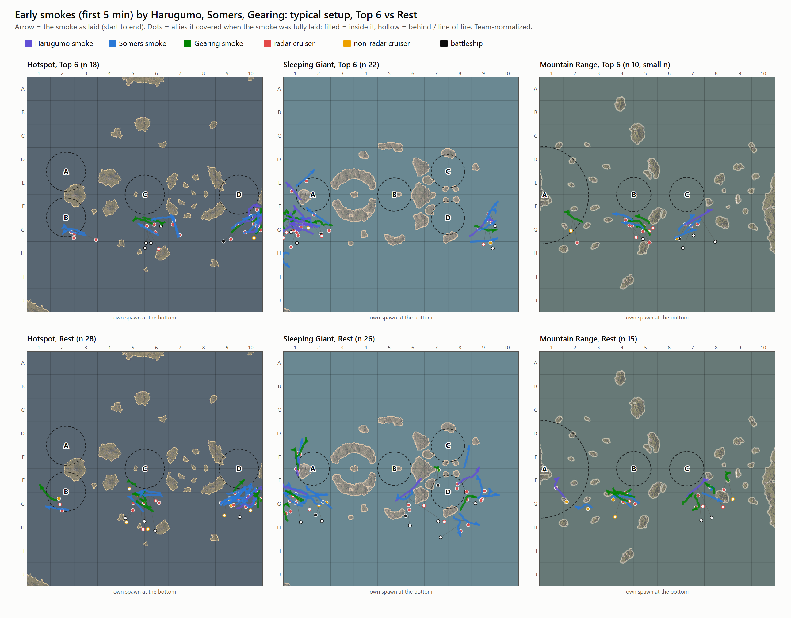
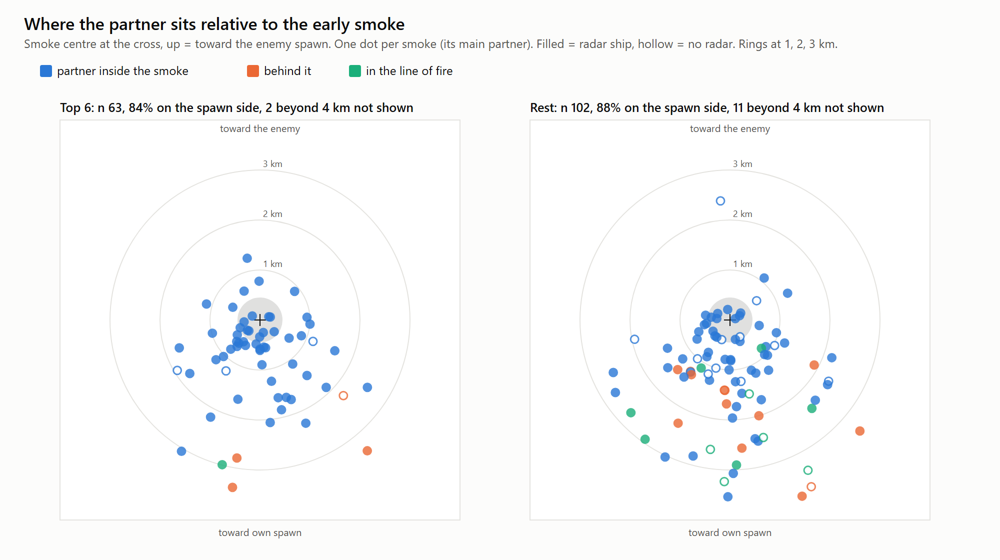
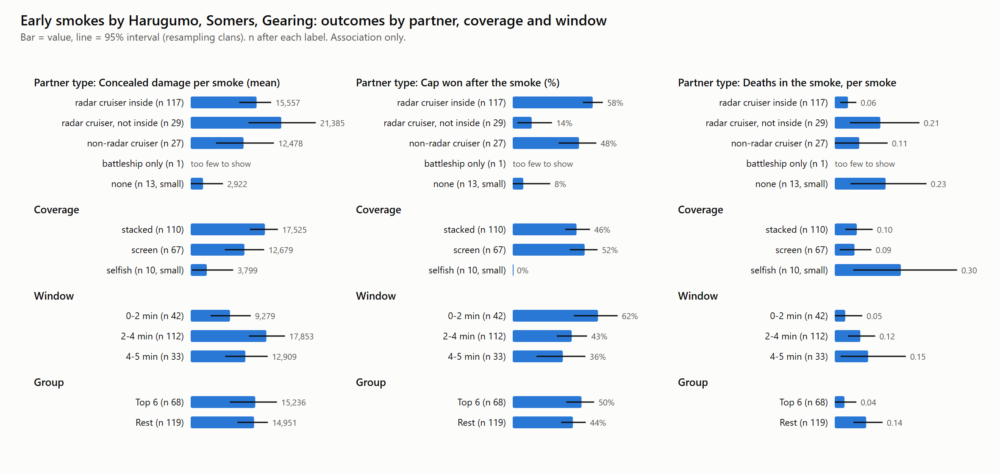
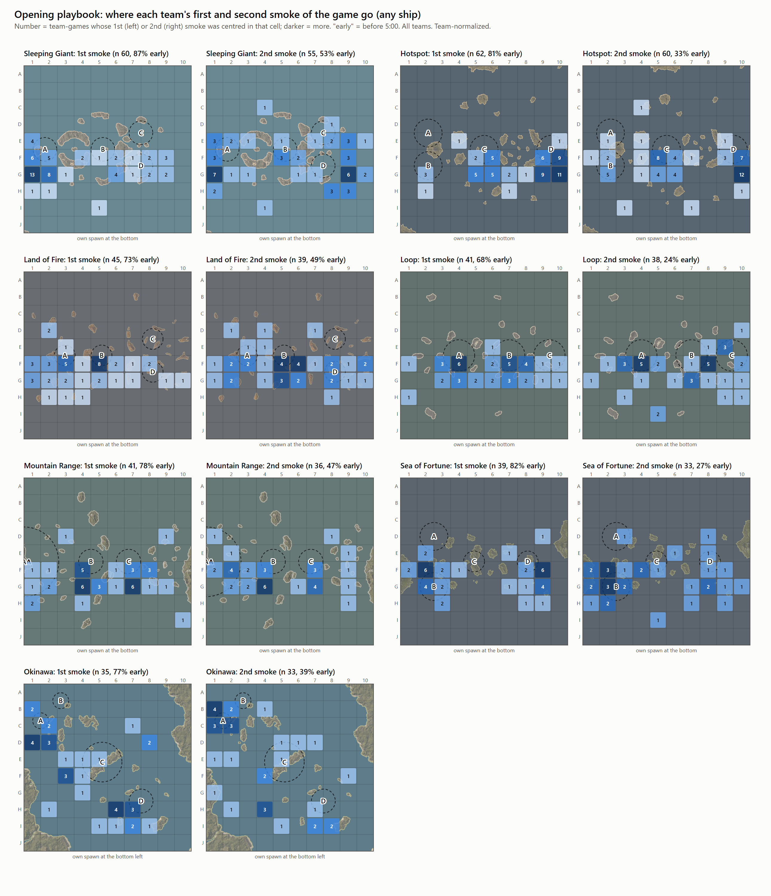

# Module 2: early smokes (first 5 minutes) by Harugumo, Somers, Gearing

Batch `output/20261117-122135`, rerun in round 4 on the corrected shared loader. 187 early smokes by these three ships (Somers 89, Gearing 68, Harugumo 30) from 27 clans in 116 games. Top 6 = 68 smokes, Rest = 119. That is 35% of all smokes these ships laid.

How to read this: positions are team-normalized, so the smoking team's spawn is always at the bottom of the map (north-spawn teams are mirrored north-south; on Okinawa, across the NW-SE diagonal, so own spawn is bottom left). Cap letters are the cap at the normalized position. Intervals are 95%, made by resampling clans; a `*` means the interval excludes zero. Everything here is association, not cause: it describes what teams do and what happened around it, not what makes a team win. Full list of the 187 smokes: [early-smokes.csv](early-smokes.csv). What changed since round 3: [CHANGES-R4.md](CHANGES-R4.md).

## The radar-partner number, one definition

Round 3 had two numbers that looked like they disagreed. Module 2 said 93% vs 70%: a radar cruiser covered in any way (inside, behind, or in the line of fire), on early smokes by the three ships. Module 3 said 77% vs 62% (Sleeping Giant 53% vs 80%): a radar ship of any class inside the smoke, on early stacked smokes by any destroyer. Both were right for their own definition. The headline from now on is **a radar cruiser inside the smoke**. "Radar cruiser" below always means that unless it says "covered in any way".

Radar cruiser inside the smoke, Top 6 vs Rest (share of smokes, n in brackets):

| Map | Three ships, early: Top 6 | Rest | Difference (interval) | All early destroyer smokes: Top 6 | Rest | Difference (interval) |
|---|---|---|---|---|---|---|
| All maps | 82% (68) | 51% (119) | +31 (+15 to +46) * | 60% (102) | 35% (200) | +25 (+13 to +35) * |
| Hotspot | 94% (18) | 57% (28) | +37 (+13 to +60) * | 87% (23) | 38% (45) | +49 (+29 to +71) * |
| Sleeping Giant | 64% (22) | 77% (26) | -13 (-40 to +18) | 47% (32) | 59% (37) | -13 (-43 to +16) |
| Mountain Range | 90% (10, small n) | 53% (15) | +37 (0 to +67) | 64% (14, small n) | 32% (25) | +32 (-9 to +71) |
| Land of Fire | 100% (5, too few) | 31% (16) | +69 (+42 to +93) * | 42% (12, small n) | 32% (25) | +10 (-23 to +49) |
| Sea of Fortune | 86% (7, too few) | 50% (12, small n) | +36 (-1 to +68) | 67% (9, small n) | 27% (22) | +39 (+16 to +62) * |
| Okinawa | 67% (3, too few) | 33% (12, small n) | +33 (-33 to +85) | 67% (3, too few) | 17% (23) | +49 (-12 to +91) |
| Loop | 100% (3, too few) | 20% (10, small n) | +80 (+58 to +100) * | 44% (9, small n) | 22% (23) | +23 (-21 to +49) |

"Too few" rows have under 8 Top 6 smokes; their starred intervals come from 1 to 4 clans and should not be leaned on. PN: 4 of its 5 early destroyer smokes (all by Somers or Harugumo) had a radar cruiser inside, small n. For reference on the new loader: the old Module 2 definition gives 93% vs 70%, the old Module 3 definition gives 77% vs 64% (Sleeping Giant 53% vs 80%).

Sleeping Giant is the one map where the gap is the other way round (not clear either way): there, Top 6 early smokes more often cover a cruiser sitting behind the smoke or a non-radar cruiser (Utrecht).

## Findings

**1. The early smoke is cover for a cruiser parked short of the cap, not a cap smoke.**
63% of early smokes (117 of 187) have a radar cruiser inside; 78% (146) cover one in any way. 59% are stacked, 36% screens, 5% selfish. Only 14% are laid inside a cap; the typical one is 1.8 km outside the cap edge. The main partner sits about 950 m on the spawn side of the smoke centre (87% of 165 with a known position) and 3.8 km outside the cap; only 4% of partners are inside the cap. The destroyer itself deals 6% of the concealed damage; the partner deals the rest. Mountain Range cap A (3 smokes) does not move these numbers.
Where: [setup-main-maps.png](setup-main-maps.png), [setup-other-maps.png](setup-other-maps.png), [partner-offsets.png](partner-offsets.png).
For a player: in the first 5 minutes these ships smoke the spot the cruiser shoots from, 1 to 2 km short of the cap, with the cruiser in the back half of the smoke.

**2. Top 6 early smokes have a radar cruiser inside far more often.**
Radar cruiser inside: Top 6 82% vs Rest 51% (+31 points, interval +15 to +46 *); per map in the table above. Main partner of any type inside the smoke rather than behind it: 88% vs 67% (+21, interval +9 to +34 *). Deaths in the smoke: 0.04 vs 0.14 per smoke (interval -0.18 to -0.02 *). Top 6 also smoke sooner (34% vs 16% in the first 2 minutes; interval -3 to +34, not clear). Concealed damage per smoke is the same (15.2k vs 15.0k; interval -7.2k to +6.3k).
Where: the setup figures (filled red dots = radar cruiser inside; hollow = behind or in the line of fire).
For a player: Top 6 smoke where a radar cruiser is already close enough to sit in the smoke. Rest smokes more often have the cruiser trailing behind or no partner. This describes a habit of the stronger teams, not a proven reason for their results.

**3. Outcomes by partner type: a radar cruiser inside goes with the cap, not with more damage.**
Radar cruiser inside (n 117): 15.6k concealed damage, cap later won 58%, 0.06 deaths per smoke. Radar cruiser covered but not inside (n 29): 21.4k, cap won 14%, 0.21 deaths. Non-radar cruiser (n 27): 12.5k, cap won 48%, 0.11 deaths. No partner (n 13, small n): 2.9k, cap won 8%, 0.23 deaths. Battleship only happened once, so it cannot be judged; smokes that include a battleship among the partners (n 44) show 18.1k damage and 0.18 deaths vs 0.07 without.
Comparisons: radar cruiser inside vs everything else: damage +1.3k (interval -3.9k to +6.8k, not clear), cap won +32 points (+22 to +43 *), deaths -0.13 (-0.23 to -0.02 *). Inside vs covered-not-inside: cap won +44 points (+32 to +54 *), damage -5.8k (-14.6k to +2.9k, not clear). Inside vs non-radar cruiser: nothing clear (damage +3.1k, -4.7k to +10.5k; cap won +10, -6 to +27). On the old "covered in any way" definition the damage gap looked real (+7.6k, +1.3k to +13.1k *); that gap came from the not-inside smokes.
Where: [outcomes.png](outcomes.png); locations in the setup figures.
For a player: smokes with the radar cruiser inside were followed by the cap being won more often and by fewer deaths. Smokes with the cruiser firing from behind returned as much or more damage but the cap was rarely won afterwards. Unpartnered early smokes returned almost nothing. Top 6 lay the first kind far more (finding 2), so team strength is mixed into this.

**4. Des Moines and Brisbane are the default partners; Top 6 Gearings go with Brisbane.**
Main partner of the 174 partnered smokes: Des Moines 51, Brisbane 42, Minotaur 21, Utrecht 14, Worcester 13. Top 6: Gearing with Brisbane (12 of 23), Harugumo with Des Moines or Worcester (10 of 15), Somers with Des Moines or Brisbane (15 of 30). Rest: Somers splits Brisbane 14, Des Moines 13, Minotaur 13; Gearing mostly Des Moines (14 of 45) and is the ship most often paired with non-radar cruisers (Napoli 5, Smolensk 3). By ship, a radar cruiser is inside 80% of Harugumo, 64% of Somers and 53% of Gearing early smokes. Smokes with a Des Moines main partner average 21.4k concealed damage (interval 13.9k to 28.5k) vs 13.0k for Brisbane (8.6k to 17.5k); the intervals overlap.
For a player: nothing actionable beyond findings 2 and 3; the pairings mostly follow which cruisers a team brings.

**5. Smokes in minutes 2 to 4 return the damage; smokes before 2:00 are quiet and safe.**
0 to 2 min (n 42): 9.3k concealed damage, 0.05 deaths, cap later won 62%. 2 to 4 min (n 112): 17.9k, 0.12 deaths, cap won 43%. 4 to 5 min (n 33): 12.9k, 0.15 deaths, cap won 36%. Intervals overlap for cap won; the damage gap between the first two windows is the clearest. Stacked smokes return more damage than screens (17.5k vs 12.7k; interval -0.2k to +9.5k) but come with a worse score swing (-3.5 vs +5.1; difference -8.6, interval -16.1 to -1.5 *). That swing result is odd and may just reflect when teams choose to screen.
For a player: the opening-push smoke is used for getting into position; the damage shows up on the 2 to 4 minute smoke once the cruiser is set.

**6. Where the early smokes go, map by map** (three ships; see the setup figures).
Top 6 and Rest smoke the same spots on the three maps with enough data. The difference is who is in the smoke (finding 2), not where it is.

| Map | n (Top 6 / Rest) | Main spots (normalized) | Usual main partner |
|---|---|---|---|
| Sleeping Giant | 22 / 26 | West flank short of A: G1, G2, E1 (31 of 48 at A); east by D: G9 | Top 6 Brisbane, Rest Des Moines |
| Hotspot | 18 / 28 | East edge under D: G10, G9, F10 (28 of 46); centre under C: G5, G6 | Des Moines, Brisbane |
| Mountain Range | 10 (small n) / 15 | Under B: G4, G5; under C: G7, F8 | Minotaur, Brisbane, Des Moines |
| Land of Fire | 5 / 16 | West around A: F1 to F3, G1 (17 of 21) | Top 6 Des Moines; Rest non-radar cruisers |
| Sea of Fortune | 7 / 12 | West: F2; east by D: F9 | Brisbane (Top 6), Des Moines (Rest) |
| Okinawa | 3 / 12 | North-west by A and B: D1, D2, C2; south-east by D: H7 | mixed |
| Loop (small n) | 3 / 10 | Between B and C: F8; by A: F3, G4 | Des Moines, Minotaur |

For a player: on Sleeping Giant and Hotspot both groups put the early smoke on one flank (G1 west, G10 east), short of the cap. On Hotspot, Top 6 have the radar cruiser inside it 94% of the time vs 57% for Rest.

**7. Opening playbook: location and timing of the first smokes do not separate teams; whether a radar cruiser is inside the first smoke does.**
Approximations: the batch has no continuous score or cap timeline. "First cap" = owner of the first cap seen held in any smoke snapshot; it is usable in only 88 of 171 games (in 82 both teams already held a cap at the first sighting, median sighting at 3:34). "Lead at 5:00" = score gap in the snapshot nearest 5:00, used when within 60 s (152 games; median 12 s away).
- A team's first smoke comes at a median 3:14 (79% before 5:00); the second at 5:29 (40% before 5:00). Half of first smokes (163 of 323 team-games) are by the three ships: Somers 71, Gearing 61, Harugumo 31.
- Timing of the first smoke, who lays it, and same cap vs two caps: every interval for first cap and 5:00 lead crosses zero. Example: first two smokes at the same cap vs split, first cap +15 points (interval -3 to +31), lead +5 (-19 to +27).
- First smoke (three ships, early) with a radar cruiser inside (n 89) vs not (n 54): lead at 5:00 +11 vs -29 points, difference +39 (interval +13 to +65 *); first cap +7 points (-19 to +27) and win rate +15 points (-6 to +32) are not clear. Top 6 do this more (finding 2) and Top 6 lead at 5:00 anyway (+28 on average, interval +11 to +47, vs -13 for Rest), so this is likely the same team-strength pattern seen again.
- When a team took the first cap, it was the cap its first smoke was at only 34% of the time (n 73). First caps are mostly taken without smoke, so first-cap results say little about smoke.
- Two weaker signals on game result: first smoke stacked vs screen, win rate 59% vs 34% (+25 points, interval +11 to +37 *, n 82 vs 53); first smoke inside the cap, win rate 71% vs 45% (n 17 vs 126, interval +1 to +47, small n). Both are habits more common in stronger teams.
Where: [opening-first-two-smokes.png](opening-first-two-smokes.png).
For a player: nothing actionable on which cap to open at. Teams whose first smoke had a radar cruiser inside were ahead at 5:00 more often; that is a description of who those teams are as much as of the smoke.

## Figures

## Supporting tables

Outcomes by partner type (early smokes, three ships). Square brackets are 95% intervals.

| Partner type | n | Concealed dmg (mean) | Kills / smoke | Deaths / smoke | Cap won | Cap defended | Score swing |
|---|---|---|---|---|---|---|---|
| Radar cruiser inside | 117 | 15.6k [12.1k, 19.1k] | 0.04 | 0.06 | 58% | 20% | +1.9 |
| Radar cruiser covered, not inside | 29 | 21.4k [13.7k, 29.4k] | 0.07 | 0.21 | 14% | 34% | -7.2 |
| Non-radar cruiser | 27 | 12.5k [5.6k, 19.9k] | 0.04 | 0.11 | 48% | 33% | -2.0 |
| Battleship only | 1 | not shown | | | | | |
| None (small n) | 13 | 2.9k [0.3k, 7.8k] | 0.00 | 0.23 | 8% | 15% | -9.8 |
| (Radar cruiser covered in any way) | 146 | 16.7k [13.5k, 20.4k] | 0.05 | 0.09 | 49% | 23% | +0.1 |

Each smoke is counted once, in the first row it fits. The last row is the old round 3 grouping (first two rows combined).

Opening by map (all ships, per team-game). Cap letters normalized.

| Map | Team-games | First smoke at | Most common first two | Usual first smoker | Top 6 vs Rest |
|---|---|---|---|---|---|
| Hotspot | 62 | D 37, C 20 | C+D 19, D+D 16 | Somers 22, Gearing 11 | same |
| Sleeping Giant | 60 | A 39, B 11, C 10 | A+C 19, A+A 14 | Somers 15, Gearing 13, Harugumo 11 | same |
| Land of Fire | 45 | A 24, B 16 | A+B 13, A+A 8 | Somers 10, Gearing 9 | Top 6 open B as often as A (6 and 6 of 15); Rest mostly A (18 of 30) |
| Loop | 41 | A 18, B 18 | A+A 9, A+C 8, B+B 8 | Daring 7 | Top 6 A+C (4 of 12, small n) |
| Mountain Range | 41 | C 18, B 14, A 9 | A+C 10, B+C 9 | Gearing 12, Somers 9 | Top 6 put both on one cap (B+B 5, C+C 4 of 16); Rest split (A+C 8, B+C 7 of 25) |
| Sea of Fortune | 39 | D 18, A 15 | D+D 8, A+A 8 | Napoli 7, Somers 7 | same |
| Okinawa | 35 | C 12, D 12, B 11 | B+C 8, B+D 8 | Gearing 6, Daring 5 | Top 6 only 6 team-games |

Per-map opening outcomes are all small n with wide intervals (see `stats.txt`), so they are not listed here.

Scripts: `m2.py` (prep), `stats.py` (numbers, writes `stats.txt` and the CSV), `figs.py` (figures), `check.py` (data checks). `stats-r3.txt` is the round 3 output kept for comparison.
