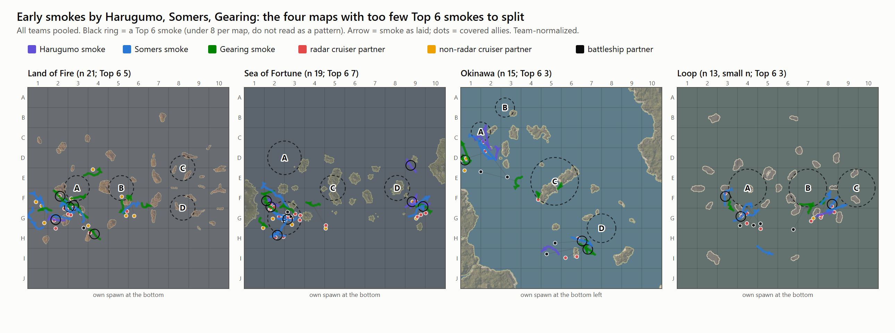

# Module 2: early smokes (first 5 minutes) by Harugumo, Somers, Gearing

Batch `output/20261117-122135`. 187 early smokes by these three ships (Somers 89, Gearing 68, Harugumo 30) from 27 clans in 116 games. Top 6 = 68 smokes, Rest = 119. That is 35% of all smokes these ships laid.

How to read this: positions are team-normalized, so the smoking team's spawn is always at the bottom of the map (north-spawn teams are mirrored north-south; on Okinawa, across the NW-SE diagonal, so own spawn is bottom left). Cap letters are the cap at the normalized position. Intervals are 95%, made by resampling clans; a `*` means the interval excludes zero. Everything here is association, not cause. Full list of the 187 smokes: [early-smokes.csv](early-smokes.csv).

## Findings

**1. The early smoke is cover for a radar cruiser parked short of the cap, not a cap smoke.**
78% of early smokes (146 of 187) cover a radar cruiser; 59% are stacked (ally sitting in it), 36% screens, 5% selfish. Only 14% are laid inside a cap; the typical one is 1.8 km outside the cap edge. The main partner sits about 950 m on the spawn side of the smoke centre (86% of 165 with a known position) and 3.7 km outside the cap; only 4% of partners are inside the cap. The destroyer itself deals 6% of the concealed damage; the partner deals the rest. Mountain Range cap A (3 smokes) does not move these numbers.
Where: [setup-main-maps.png](setup-main-maps.png), [setup-other-maps.png](setup-other-maps.png), [partner-offsets.png](partner-offsets.png).
For a player: in the first 5 minutes, smoke the spot your radar cruiser wants to shoot from (1 to 2 km short of the cap), and lay it so the cruiser is in the back half.

**2. Top 6 almost always pair the early smoke with a radar cruiser, and the cruiser is actually inside it.**
Radar cruiser partner: Top 6 93% vs Rest 70% (difference +23 points, interval +10 to +36 *). Main partner inside the smoke (not behind it): 88% vs 67% (+21, interval +9 to +34 *). Deaths in the smoke: 0.04 vs 0.14 per smoke (interval -0.18 to -0.02 *). Top 6 also smoke sooner (34% vs 16% in the first 2 minutes; interval -1 to +33, not clear). Concealed damage per smoke is the same (15.2k vs 15.0k; interval -7.3k to +6.4k).
Where: same three figures. PN (5 early smokes, small n): 4 Somers and 1 Harugumo, 4 of 5 with a radar cruiser, low damage (0 to 17k).
For a player: before you press smoke, check a radar cruiser is close enough to sit in it. Rest teams leave the smoke unpartnered or with the partner trailing behind far more often.

**3. A partner matters much more than which partner.**
Mean concealed damage per smoke: radar cruiser 16.7k (n 146), non-radar cruiser 12.5k (n 27), no partner 2.9k (n 13, small n). Radar vs non-radar cruiser: +4.2k, interval -3.2k to +11.1k, not clear. Radar cruiser vs everything else: +7.6k (interval +1.2k to +13.5k *) and cap won 49% vs 34% (+15 points, interval +3 to +30 *). Unpartnered smokes: cap won 8%, 0.23 deaths per smoke. "Battleship only" happened once, so it cannot be judged; smokes that include a battleship among the partners (n 44) show 18.1k damage but 0.18 deaths vs 0.07 without.
Where: [outcomes.png](outcomes.png); locations in the setup figures (red, yellow, black dots).
For a player: never spend the early smoke alone. A non-radar cruiser partner is not clearly worse than a radar one in this sample.

**4. Des Moines and Brisbane are the default partners; Top 6 Gearings go with Brisbane.**
Main partner of the 174 partnered smokes: Des Moines 51, Brisbane 42, Minotaur 21, Utrecht 14, Worcester 13. Top 6: Gearing with Brisbane (12 of 23), Harugumo with Des Moines or Worcester (10 of 15), Somers with Des Moines or Brisbane (15 of 30). Rest: Somers splits Brisbane 14, Des Moines 13, Minotaur 13; Gearing mostly Des Moines (14 of 45) and is the ship most often paired with non-radar cruisers (Napoli, Smolensk). Smokes with a Des Moines main partner average 21.4k concealed damage (interval 14.0k to 28.5k) vs 13.0k for Brisbane (8.5k to 17.3k); the intervals overlap.
For a player: nothing actionable beyond finding 2 and 3; the pairings mostly follow which cruisers a team brings.

**5. Smokes in minutes 2 to 4 do the damage; smokes before 2:00 are quiet and safe.**
0 to 2 min (n 42): 9.3k concealed damage, 0.05 deaths, cap later won 62%. 2 to 4 min (n 112): 17.9k, 0.12 deaths, cap won 43%. 4 to 5 min (n 33): 12.9k, 0.15 deaths, cap won 36%. Intervals overlap for cap won; the damage gap between the first two windows is the clearest. Stacked smokes do more damage than screens (17.5k vs 12.7k; interval -0.4k to +9.8k) but come with a worse score swing (-3.5 vs +5.1; difference -8.6, interval -16.6 to -1.5 *). That swing result is odd and may just reflect when teams choose to screen.
For a player: the opening-push smoke is a positioning tool; expect the payoff from the 2 to 4 minute smoke once the cruiser is set.

**6. Where the early smokes go, map by map** (three ships; see the setup figures).
Top 6 and Rest use the same spots on the three maps with enough data. Differences are in partner use (finding 2), not location.

| Map | n (Top 6 / Rest) | Main spots (normalized) | Usual main partner |
|---|---|---|---|
| Sleeping Giant | 22 / 26 | West flank short of A: G1, G2, E1 (31 of 48 at A); east by D: G9 | Top 6 Brisbane, Rest Des Moines |
| Hotspot | 18 / 28 | East edge under D: G10, G9, F10 (28 of 46); centre under C: G5, G6 | Des Moines, Brisbane |
| Mountain Range | 10 (small n) / 15 | Under B: G4, G5; under C: G7, F8 | Minotaur, Brisbane, Des Moines |
| Land of Fire | 5 / 16 | West around A: F1 to F3, G1 (17 of 21) | Top 6 Des Moines; Rest non-radar cruisers |
| Sea of Fortune | 7 / 12 | West: F2; east by D: F9 | Brisbane (Top 6), Des Moines (Rest) |
| Okinawa | 3 / 12 | North-west by A and B: D1, D2, C2; south-east by D: H7 | mixed |
| Loop (small n) | 3 / 10 | Between B and C: F8; by A: F3, G4 | Des Moines, Minotaur |

For a player: on Sleeping Giant and Hotspot the early smoke goes to one flank (G1 west, G10 east) and sits short of the cap; copy the spot, then make sure the cruiser is in it.

**7. Opening playbook: no opening smoke pattern clearly goes with the first cap or the 5:00 lead.**
Approximations: the batch has no continuous score or cap timeline. "First cap" = owner of the first cap seen held in any smoke snapshot; it is usable in only 87 of 171 games (in 83 both teams already held a cap at the first sighting, median sighting at 3:34). "Lead at 5:00" = score gap in the snapshot nearest 5:00, used when within 60 s (152 games; median 12 s away).
- A team's first smoke comes at a median 3:14 (79% before 5:00); the second at 5:29 (40% before 5:00). Half of first smokes (163 of 323 team-games) are by the three ships: Somers 71, Gearing 61, Harugumo 31.
- Timing of the first smoke, who lays it, radar cruiser partner or not, and same cap vs two caps: every interval for first cap and 5:00 lead crosses zero. Example: first two smokes at the same cap vs split, first cap +14 points (interval -4 to +29), lead +5 (-19 to +28).
- When a team took the first cap, it was the cap its first smoke was at only 35% of the time (n 72). First caps are mostly taken without smoke, so first-cap results say little about smoke.
- Two weaker signals on game result, not on the 5:00 state: first smoke (three ships, early) stacked vs screen, win rate 59% vs 34% (+25 points, interval +11 to +38 *, n 82 vs 53); first smoke inside the cap, win 71% vs 45% (n 17 vs 126, interval +0 to +44, small n). Stronger teams stack more (finding 2), so do not read this as cause.
- Top 6 lead at 5:00 by 28 points on average (interval +11 to +48) vs -13 for Rest, but their opening smokes look like everyone else's on timing and location.
Where: [opening-first-two-smokes.png](opening-first-two-smokes.png).
For a player: nothing actionable on which cap to open at. The usable part is the same as finding 2: make the first smoke a stacked one.

## Figures

## Supporting tables

Outcomes by partner type (early smokes, three ships). Square brackets are 95% intervals.

| Partner type | n | Concealed dmg (mean) | Kills / smoke | Deaths / smoke | Cap won | Cap defended | Score swing |
|---|---|---|---|---|---|---|---|
| Radar cruiser | 146 | 16.7k [13.2k, 20.2k] | 0.05 | 0.09 | 49% | 23% | +0.1 |
| Non-radar cruiser | 27 | 12.5k [5.8k, 19.9k] | 0.04 | 0.11 | 48% | 33% | -2.0 |
| Battleship only | 1 | not shown | | | | | |
| None (small n) | 13 | 2.9k [0, 7.9k] | 0.00 | 0.23 | 8% | 15% | -9.8 |

Each smoke is counted once: radar cruiser if any covered ally is one, else non-radar cruiser, else battleship.

Opening by map (all ships, per team-game). Cap letters normalized.

| Map | Team-games | First smoke at | Most common first two | Usual first smoker | Top 6 vs Rest |
|---|---|---|---|---|---|
| Hotspot | 62 | D 37, C 20 | C+D 19, D+D 16 | Somers 22, Gearing 11 | same |
| Sleeping Giant | 60 | A 39, B 11, C 10 | A+C 19, A+A 14 | Somers 15, Gearing 13, Harugumo 11 | same |
| Land of Fire | 45 | A 24, B 16 | A+B 13, A+A 8 | Somers 10, Gearing 9 | Top 6 open B as often as A (6 and 6 of 15); Rest mostly A (18 of 30) |
| Loop | 41 | A 18, B 18 | A+A 9, A+C 8, B+B 8 | Daring 7 | Top 6 A+C (4 of 12, small n) |
| Mountain Range | 41 | C 18, B 14, A 9 | A+C 10, B+C 9 | Gearing 12, Somers 9 | Top 6 put both on one cap (B+B 5, C+C 4 of 16); Rest split (A+C 8, B+C 7 of 25) |
| Sea of Fortune | 39 | D 18, A 15 | D+D 8, A+A 8 | Napoli 7, Somers 7 | same |
| Okinawa | 35 | C 12, D 12, B 11 | B+C 8, B+D 8 | Gearing 6, Daring 5 | Top 6 only 6 team-games |

Per-map opening outcomes are all small n with wide intervals (see `stats.txt`), so they are not listed here.

Scripts: `m2.py` (prep), `stats.py` (numbers, writes `stats.txt` and the CSV), `figs.py` (figures), `check.py` (data checks).
