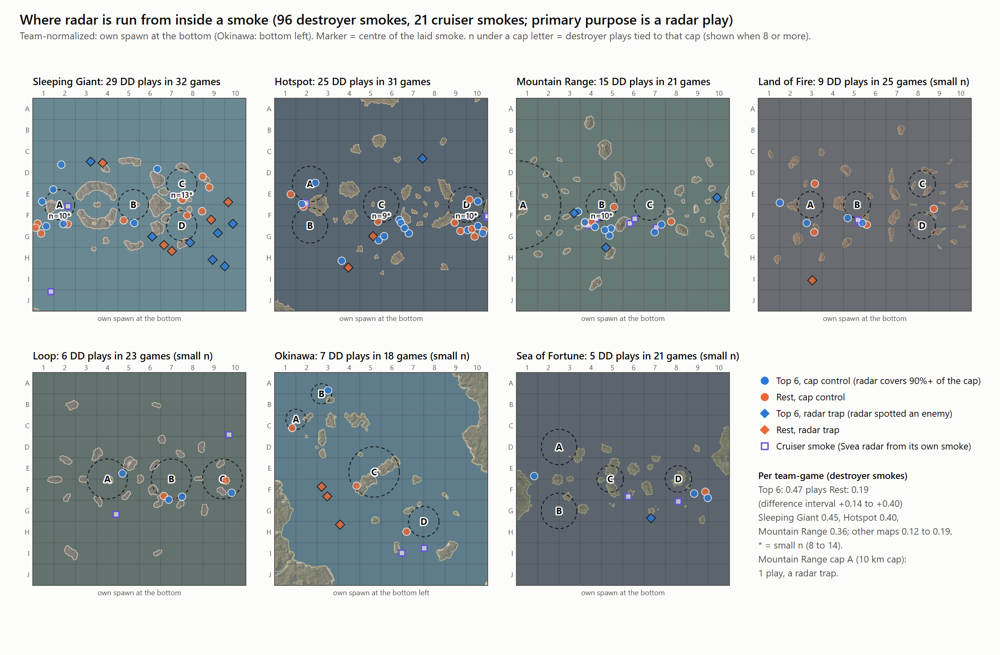
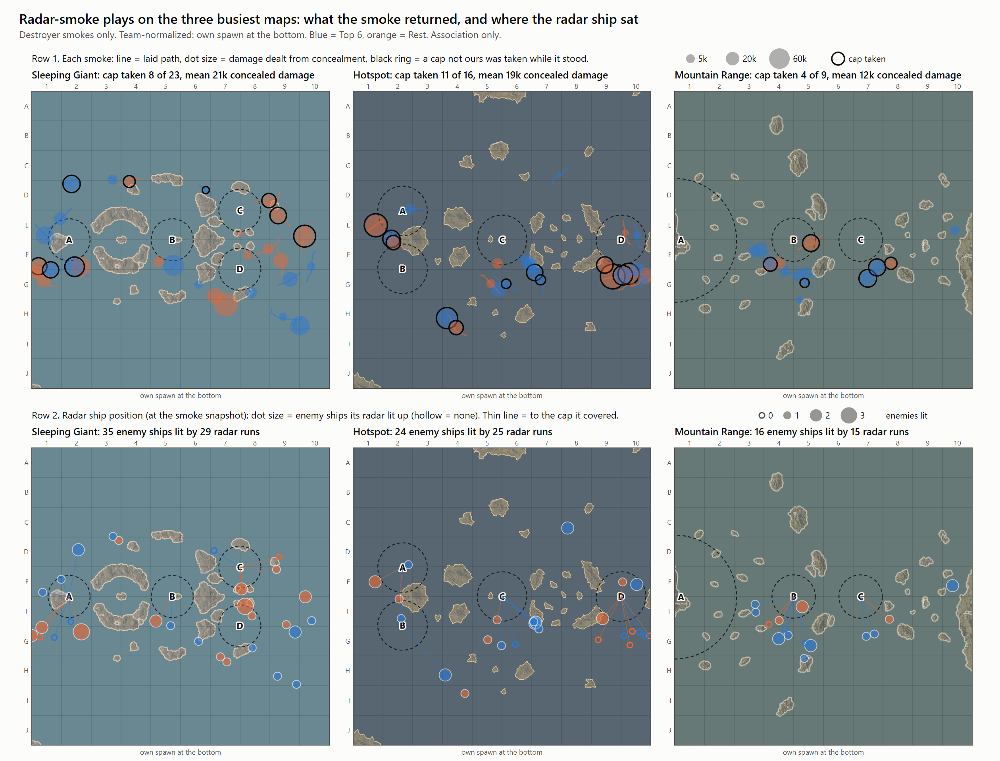

# Module 3: radar + smoke (round 4 rerun)

Batch `output/20261117-122135` (1,547 smokes, 171 games), corrected shared loader. Destroyer (DD) smokes unless a line says cruiser.
Top 6 = H-SR, RESIN, BONKZ, HTDOG, KITE, VRTUS (110 team-games). Rest = everyone else (232 team-games).

How to read it:

- **Radar play** = a smoke whose primary purpose is a radar play (`radar_play`): 96 DD smokes. Two kinds: **cap control** (a radar ship hidden in the smoke ran radar while it covered 90% or more of the contested cap; 73) and **radar trap** (it did not cover the cap, but lit up at least one enemy; 23). Round 3 counted any radar tag, primary or not (100 smokes, 0.50 per Top 6 team-game).
- Positions are team-normalized: the smoking team's spawn is always at the bottom of the map. North-spawn teams are mirrored north-south; on Okinawa (spawns NE and SW) they are mirrored across the NW-SE diagonal. Cap letters are the letter at the normalized position.
- Intervals are 95%, from resampling clans. Everything here is association, not cause: it describes what the Top 6 do and where, and what those smokes returned. It does not show that any of it makes a team win. A radar play is only logged when the radar ship stayed hidden in the smoke, so these are partly "smokes that held up".

## Findings

**1. The Top 6 run radar from smoke about 2.5 times as often.** 0.47 DD radar plays per team-game against 0.19 for the Rest (difference +0.28, interval +0.14 to +0.40; 52 and 44 smokes). 38% of Top 6 team-games have at least one radar play (any class), against 17%. H-SR (14 plays in 22 games) and RESIN (14 in 24) lead; BONKY and HFANS are the Rest clans that play this way. PN: 1 play in 7 games (small n). See fig 4.
For a player: the Top 6 run radar from a smoke in about 4 of every 10 games. Most teams outside the top do not.

**2. It is a three-map play, and it has fixed addresses.** Sleeping Giant, Hotspot and Mountain Range hold 69 of the 96 DD radar plays (0.45, 0.40 and 0.36 per team-game; the other four maps 0.12 to 0.19). See fig 1.
- Sleeping Giant: west cap A from below it (cells G1, F2, E1; 10 plays, 9 cap control, Brisbane in 6) and the far east cap C (13 plays; never the near east cap D). Small n for both.
- Hotspot: east cap D, 10 plays, all cap control, 6 of them in cell G10 (small n); centre cap C from the south (G5 to G7), 9 plays.
- Mountain Range: centre cap B from F4/G5, 10 plays (small n). The big 10 km cap A has 1 play, a trap; it drives nothing here.
For a player: on these three maps the radar smoke sits on the own-spawn side of the cap, with the radar ship 4 to 7 km from the cap centre (fig 2, row 2), not inside it. Only 36% of cap-control smokes are inside the cap, against 68% of ordinary cap-contest smokes.

**3. Cap control is an opening play; radar traps come late and away from caps.** 42% of cap-control smokes are in the first 5 minutes, against 27% of other DD smokes (+15 points, interval +4 to +25). Traps: median 10:06, 57% after minute 10, a median 7 km from the nearest contested cap (n=23). See fig 4.
For a player: teams use the radar smoke to open a cap. Later in the game the same pairing shows up on a lane, away from caps.

**4. Smokes where radar was pressed hit enemy destroyers more often; total damage is about the same.** Among DD smokes that already have a radar ship inside (n=387), radar was run in 95. Those damaged an enemy DD 62% of the time against 36% when radar was not run (+26 points, interval +17 to +34), with +1.9k more damage on DDs per smoke (interval +0.8k to +3.0k). Total concealed damage (+3.3k, interval -0.6k to +7.8k), caps taken (+8 points, -7 to +21) and kills are not clearly different.
For a player: where the radar was pressed, the return was hits on the enemy destroyer, not a bigger damage total.

**5. The damage and the caps go with a cruiser being in the smoke, whether or not radar is pressed.** Cap-control smokes: a cap not already ours was taken in 58% (of 50) and mean concealed damage was 19.1k. Ordinary cap-contest smokes: 42% (of 212) and 8.4k (differences +16 points, interval +0 to +30, borderline; +10.7k, interval +6.2k to +16.4k). But cap-contest smokes with a radar ship inside that did not make the play returned as much: 74% (of 53) and 17.0k. Smokes with no radar ship inside: 32% and 5.3k.
For a player: the cap smokes that returned the most had the cruiser stacked in them. The radar press itself shows no extra return on caps.

**6. Top 6 and Rest get the same return per play; the Top 6 just do it more.** Cap control: cap taken 58% for both (24 and 26 smokes); concealed damage 17.8k against 20.8k (interval -13.1k to +4.7k). Enemies lit per radar run: 1.1 for both. Per team-game the Top 6 light 0.61 enemy ships from smoke against 0.25 (interval +0.13 to +0.61). Radar is pressed in 29% (Top 6) and 20% (Rest) of smokes that have a radar ship inside (interval +0 to +17, borderline).
For a player: nothing special in the execution to copy. The gap is frequency.

**7. Early smokes: the Top 6 have a radar cruiser inside far more often, except on Sleeping Giant.**
Definitions. Round 3 of this module reported 77% vs 62% (Sleeping Giant 53% vs 80%) for "a radar ship of any class inside" on early stacked DD smokes. Module 2 reported 93% vs 70% for "a radar cruiser covered in any way (inside, behind or in the line of fire)" on early smokes by Harugumo, Somers and Gearing. Both modules now use one headline definition: **a radar cruiser inside the smoke** (`radar_ca_inside`), early = first 5 minutes.
- (a) All early DD smokes: Top 6 60% (61 of 102), Rest 35% (70 of 200), difference +25 points (interval +13 to +36). Hotspot is the clearest map: 87% of 23 against 38% of 45 (+49, interval +30 to +70).
- (b) Early stacked DD smokes: Top 6 75% (42 of 56), Rest 62% (53 of 85), difference +13 points (interval -1 to +29, not conclusive). The gap is wider outside stacks: early smokes that are not stacks have a radar cruiser inside in 41% (19 of 46) for the Top 6 against 15% (17 of 115) for the Rest.
- Sleeping Giant: the reversal keeps its direction but is smaller and not conclusive under the headline definition. All early smokes: Top 6 47% of 32, Rest 59% of 37 (-13 points, interval -41 to +18). Early stacks: 53% of 19 against 75% of 20 (-22, interval -50 to +9; round 3 had -27). It is the only map where the Top 6 are not ahead.
- Early smokes with a radar cruiser inside stood near a cap capture more often: 61% (of 120 caps not ours) against 31% (of 150), +30 points (interval +21 to +38). Among early stacks only: 52% of 88 against 37% of 41 (+16, interval -2 to +33).
- PN: 4 of 5 early DD smokes and 3 of 3 early stacks had a radar cruiser inside (small n).
For a player: on Hotspot the Top 6 open with the radar cruiser in the smoke at east cap D (10 of 12) and centre cap C (7 of 8). On Sleeping Giant about half of Top 6 early smokes have no radar cruiser in them, mostly on the west cap A flank (10 of 22 without). See fig 3.

**8. Cruiser smokes: this is the Svea only.** All 21 cruiser radar plays are a Svea running radar from its own smoke (12 Top 6, 9 Rest; 10 of them BONKZ and HTDOG). Mean concealed damage 10.7k against 7.0k for other Svea smokes; cap taken 27% of 11 (small n). Mountain Range caps B and C have 7 of the 21.
For a player: nothing actionable beyond "a Svea does the play alone"; the sample is small.

## Figures

## Supporting tables

DD radar plays by map and cap (caps with 8 or more plays; every row is small n, under 15):

| Map | Cap | Plays | Cap control | Top 6 | First 5 min | Cap taken (not ours at start) | Mean concealed dmg | Usual cells | Usual radar ship |
|---|---|---|---|---|---|---|---|---|---|
| Sleeping Giant | C | 13 | 6 | 6 | 23% | 4 of 13 | 15.4k | F8, E10, H10 | Des Moines, Brisbane |
| Sleeping Giant | A | 10 | 9 | 6 | 50% | 3 of 5 | 23.9k | G1, F2, E1 | Brisbane |
| Hotspot | D | 10 | 10 | 4 | 60% | 4 of 7 | 22.1k | G10, E10 | Brisbane, Des Moines |
| Hotspot | C | 9 | 7 | 7 | 44% | 2 of 4 | 10.9k | G5, G7, F6 | Moskva, Brisbane |
| Mountain Range | B | 10 | 9 | 7 | 40% | 1 of 6 | 11.1k | G5, F4 | Brisbane, Gdansk |

Radar run or not, DD smokes with a radar ship inside:

| | n | Hit an enemy DD | Dmg on DDs | Concealed dmg | Cap taken | Kills per 100 | Own deaths per 100 |
|---|---|---|---|---|---|---|---|
| Radar run | 95 | 62% | 3.9k | 19.7k | 52% of 67 | 9 | 12 |
| Radar not run | 292 | 36% | 2.0k | 16.4k | 45% of 202 | 13 | 13 |

Radar cruiser inside the smoke, (a) all early DD smokes (* = under 15 smokes; difference in points, 95% interval):

| Map | Top 6 | Rest | Difference |
|---|---|---|---|
| All maps | 61 of 102 (60%) | 70 of 200 (35%) | +25 (+13 to +36) |
| Sleeping Giant | 15 of 32 (47%) | 22 of 37 (59%) | -13 (-41 to +18) |
| Hotspot | 20 of 23 (87%) | 17 of 45 (38%) | +49 (+30 to +70) |
| Mountain Range | 9 of 14* (64%) | 8 of 25 (32%) | +32 (-10 to +71) |
| Land of Fire | 5 of 12* (42%) | 8 of 25 (32%) | +10 (-23 to +47) |
| Loop | 4 of 9* (44%) | 5 of 23 (22%) | +23 (-23 to +48) |
| Okinawa | 2 of 3* (67%) | 4 of 23 (17%) | +49 (-17 to +92) |
| Sea of Fortune | 6 of 9* (67%) | 6 of 22 (27%) | +39 (+15 to +62) |

Radar cruiser inside the smoke, (b) early stacked DD smokes:

| Map | Top 6 | Rest | Difference |
|---|---|---|---|
| All maps | 42 of 56 (75%) | 53 of 85 (62%) | +13 (-1 to +29) |
| Sleeping Giant | 10 of 19 (53%) | 15 of 20 (75%) | -22 (-50 to +9) |
| Hotspot | 11 of 12* (92%) | 14 of 22 (64%) | +28 (+1 to +52) |
| Mountain Range | 6 of 6* | 8 of 9* | +11 (0 to +30) |
| Land of Fire | 5 of 7* | 6 of 11* | +17 (-33 to +70) |
| Loop | 3 of 4* | 4 of 9* | +31 (-63 to +75) |
| Okinawa | 2 of 2* | 2 of 6* | +67 (+33 to +100) |
| Sea of Fortune | 5 of 6* | 4 of 8* | +33 (-14 to +72) |

Per-map intervals with a starred cell rest on a handful of clans; read them as direction only.

## Limits

- The data has no "damage dealt to radar-spotted targets" figure. The column `radar_spotted_damage` is damage our own ships took while enemy radar lit them. Finding 4 uses damage on enemy destroyers from the smoke as the nearest stand-in.
- Which radar lit an enemy is inferred from timing and range, so a second radar in range at the same moment is counted too.
- No map cell has 8 or more radar plays (the most is 6, Hotspot G10), so cells are shown as dots and named only as "usual cells", not as rates.
- Findings 4 to 6 still use "a radar ship of any class inside" to pick smokes where radar could have been pressed (this includes a Gdansk in its own smoke); only finding 7 uses the radar cruiser headline definition.
- Scripts: `m3lib.py` (helpers), `tables.py`, `tables2.py`, `tables3.py` (numbers; outputs saved in `runs/`), `figs.py` (figures). Changes from round 3 are listed in `CHANGES-R4.md`.
