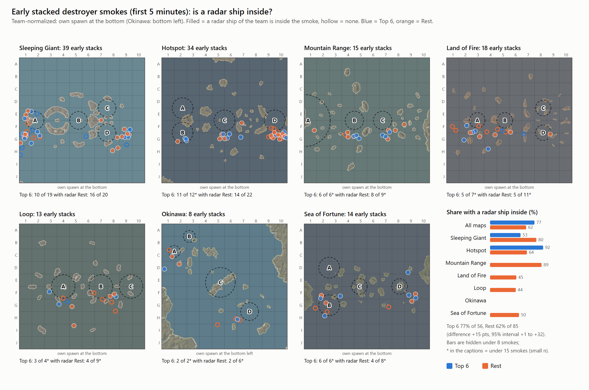
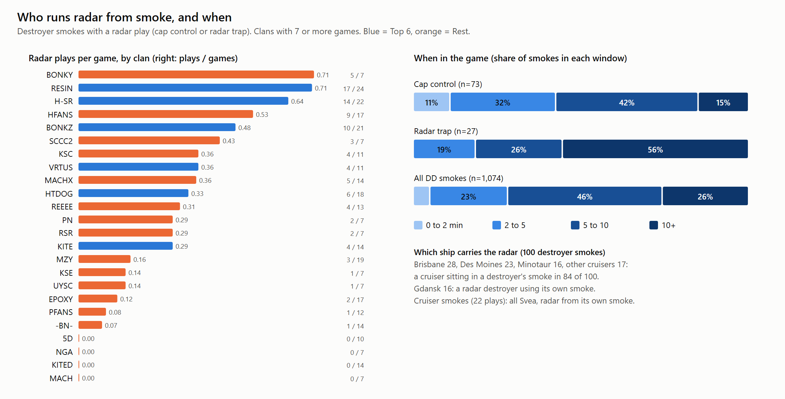

# Module 3: radar + smoke

Batch `output/20261117-122135` (1,547 smokes, 171 games). Destroyer (DD) smokes unless a line says cruiser.
Top 6 = H-SR, RESIN, BONKZ, HTDOG, KITE, VRTUS (110 team-games). Rest = everyone else (232 team-games).

How to read it:

- **Radar play** = a radar ship hidden inside the smoke ran its radar. Two kinds: **cap control** (the radar covered 90% or more of the contested cap; 73 DD smokes) and **radar trap** (it did not cover the cap, but lit up at least one enemy; 27 DD smokes).
- Positions are team-normalized: the smoking team's spawn is always at the bottom of the map. North-spawn teams are mirrored north-south; on Okinawa (spawns NE and SW) they are mirrored across the NW-SE diagonal. Cap letters are the letter at the normalized position.
- Intervals are 95%, from resampling clans. Everything here is association, not cause. A radar play is only logged when the radar ship stayed hidden in the smoke, so these are partly "smokes that held up".

## Findings

**1. The Top 6 run radar from smoke about 2.5 times as often.** 0.50 DD radar plays per team-game against 0.19 for the Rest (difference +0.31, interval +0.14 to +0.44; 55 and 45 smokes). 40% of Top 6 team-games have at least one, against 17%. RESIN (17 plays in 24 games) and H-SR (14 in 22) lead; BONKY and HFANS are the Rest clans that play this way. PN: 2 plays in 7 games (small n). See fig 4.
For a player: if your lineup has a radar cruiser, plan one smoke per game for it. Most teams outside the top do not.

**2. It is a three-map play, and it has fixed addresses.** Sleeping Giant, Hotspot and Mountain Range hold 72 of the 100 DD radar plays (0.40 to 0.45 per team-game; the other four maps 0.12 to 0.19). See fig 1.
- Sleeping Giant: west cap A from below it (cells G1, F2, E1; 10 plays, 9 cap control, Brisbane in 6) and the far east cap C (13 plays; never the near east cap D). Small n for both.
- Hotspot: east cap D, 10 plays, all cap control, 6 of them in cell G10 (small n); centre cap C from the south (G5 to G7), 9 plays.
- Mountain Range: centre cap B from F4/G5, 10 plays (small n). The big 10 km cap A has only 4 plays, all traps; it drives nothing here.
For a player: on these three maps, the smoke for the radar cruiser goes on the own-spawn side of the cap, 4 to 7 km from its centre (fig 2, row 2), not inside it. Only 36% of cap-control smokes are inside the cap, against 68% of ordinary cap-contest smokes.

**3. Cap control is an opening play; radar traps come late and away from caps.** 42% of cap-control smokes are in the first 5 minutes, against 27% of other DD smokes (+15 points, interval +4 to +25). Traps: median 10:06, 56% after minute 10, a median 6 km from the nearest contested cap (n=27). See fig 4.
For a player: use the radar smoke to open a cap. Later in the game the same pairing works as an ambush on a lane rather than on a cap.

**4. Pressing radar goes with hitting enemy destroyers, not with more total damage.** Among DD smokes that already have a radar ship inside (n=385), radar was run in 95. Those damaged an enemy DD 62% of the time against 36% when radar was not run (+26 points, interval +17 to +35), with +1.9k more damage on DDs per smoke (interval +0.8k to +3.0k). Total concealed damage (+3.3k, interval -0.7k to +7.5k), caps taken (+8 points, -6 to +21) and kills are not clearly different.
For a player: the radar's return is hits on their destroyer. Have guns ready on the cap before the button is pressed.

**5. The damage and the caps go with having the cruiser in the smoke; the radar press adds little on top.** Cap-control smokes: a cap not already ours was taken in 58% (of 50) and mean concealed damage was 19.1k. Ordinary cap-contest smokes: 42% (of 212) and 8.4k (differences +16 points, interval +0 to +30, borderline; +10.7k, interval +6.2k to +16.4k). But cap-contest smokes with a radar ship inside that did not make the play do as well: 74% (of 53) and 17.0k. Smokes with no radar ship inside: 32% and 5.3k.
For a player: stack the cruiser in the smoke at the cap. That is where the numbers move. Do not expect the radar itself to win the cap.

**6. Top 6 and Rest get the same return per play; the Top 6 just do it more.** Cap control: cap taken 58% for both (24 and 26 smokes); concealed damage 17.8k against 20.8k (interval -13.1k to +4.7k). Enemies lit per radar run: 1.1 for both. Per team-game the Top 6 light 0.61 enemy ships from smoke against 0.25 (interval +0.13 to +0.61). Radar is pressed in only 29% (Top 6) and 20% (Rest) of smokes that have a radar ship inside (interval -1 to +17).
For a player: nothing special in the execution to copy. The gap is frequency.

**7. Early stacks: the Top 6 include a radar ship more often overall, but not on Sleeping Giant.** Early stacked DD smokes with a radar ship inside: Top 6 77% (of 56), Rest 62% (of 85), difference +15 points (interval +1 to +32). By map (fig 3): Hotspot 92% of 12 (small n) against 64% of 22; Sleeping Giant reversed, 53% of 19 against 80% of 20 (interval -56 to +5, not conclusive). Other maps have under 10 Top 6 early stacks each. Early stacks with a radar ship took the cap in 53% (of 89) against 35% (of 40) without (+18 points, interval +0 to +35, borderline). PN: 3 early stacks, all 3 with a radar ship (small n).
For a player: on Hotspot the opening stack is a radar stack (east cap D and centre cap C). On Sleeping Giant the Top 6 often open the west cap A flank with a stack that has no radar ship.

**8. Cruiser smokes: this is the Svea only.** All 22 cruiser radar plays are a Svea running radar from its own smoke (13 Top 6, 9 Rest; 11 of them BONKZ and HTDOG). Mean concealed damage 11.0k against 7.0k for other Svea smokes; cap taken 25% of 12 (small n). Mountain Range caps B and C have 7 of the 22.
For a player: nothing actionable beyond "a Svea can do the play alone"; the sample is small.

## Figures

## Supporting tables

DD radar plays by map and cap (caps with 8 or more plays; every row is small n, under 15):

| Map | Cap | Plays | Cap control | Top 6 | First 5 min | Cap taken (not ours at start) | Mean concealed dmg | Usual cells | Usual radar ship |
|---|---|---|---|---|---|---|---|---|---|
| Sleeping Giant | C | 13 | 6 | 6 | 23% | 4 of 13 | 15.4k | F8, E10, H10 | Des Moines, Brisbane |
| Sleeping Giant | A | 10 | 9 | 6 | 50% | 3 of 5 | 23.9k | G1, F2, E1 | Brisbane |
| Hotspot | D | 10 | 10 | 4 | 60% | 4 of 7 | 22.1k | G10, E10 | Brisbane, Des Moines |
| Hotspot | C | 9 | 7 | 7 | 44% | 2 of 4 | 10.9k | G5, G7, F6 | Moskva, Brisbane |
| Mountain Range | B | 10 | 9 | 7 | 40% | 1 of 6 | 11.1k | G5, F4 | Brisbane, Gdansk |

Radar run or not, DD smokes with a radar ship inside:

| | n | Hit an enemy DD | Dmg on DDs | Concealed dmg | Cap taken | Kills per 100 | Own deaths per 100 |
|---|---|---|---|---|---|---|---|
| Radar run | 95 | 62% | 3.9k | 19.7k | 52% of 67 | 9 | 12 |
| Radar not run | 290 | 36% | 2.0k | 16.4k | 44% of 200 | 13 | 13 |

Early stacked DD smokes with a radar ship inside, by map (* = under 15 smokes):

| Map | Top 6 | Rest |
|---|---|---|
| Sleeping Giant | 10 of 19 (53%) | 16 of 20 (80%) |
| Hotspot | 11 of 12* (92%) | 14 of 22 (64%) |
| Mountain Range | 6 of 6* | 8 of 9* |
| Land of Fire | 5 of 7* | 5 of 11* |
| Loop | 3 of 4* | 4 of 9* |
| Okinawa | 2 of 2* | 2 of 6* |
| Sea of Fortune | 6 of 6* | 4 of 8* |

## Limits

- The data has no "damage dealt to radar-spotted targets" figure. The column `radar_spotted_damage` is damage our own ships took while enemy radar lit them. Finding 4 uses damage on enemy destroyers from the smoke as the nearest stand-in.
- Which radar lit an enemy is inferred from timing and range, so a second radar in range at the same moment is counted too.
- No map cell has 8 or more radar plays (the most is 6, Hotspot G10), so cells are shown as dots and named only as "usual cells", not as rates.
- Scripts: `m3lib.py` (helpers), `tables.py` and `tables2.py` (numbers), `figs.py` (figures).
