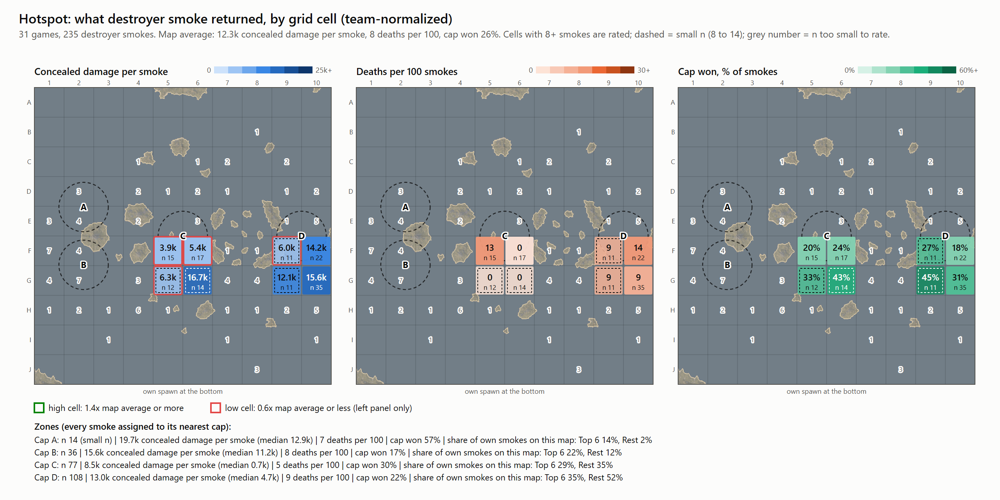
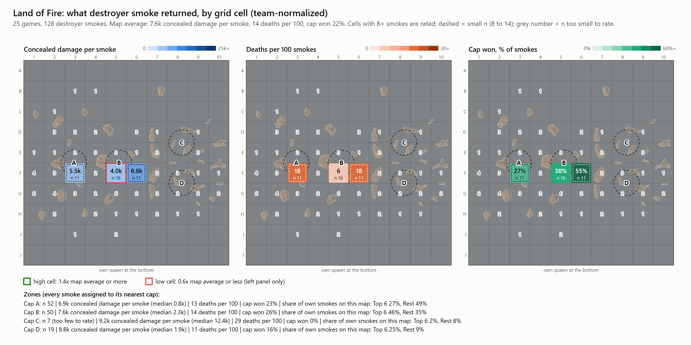
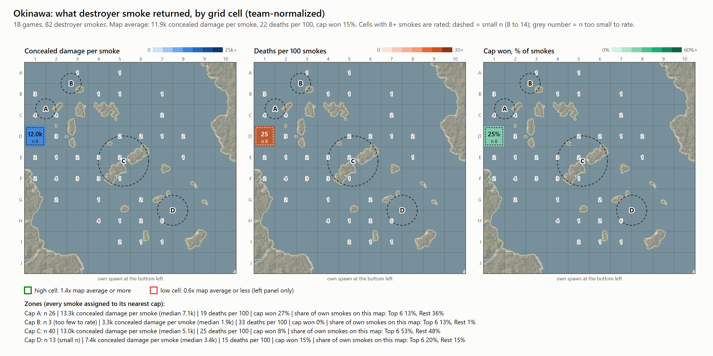
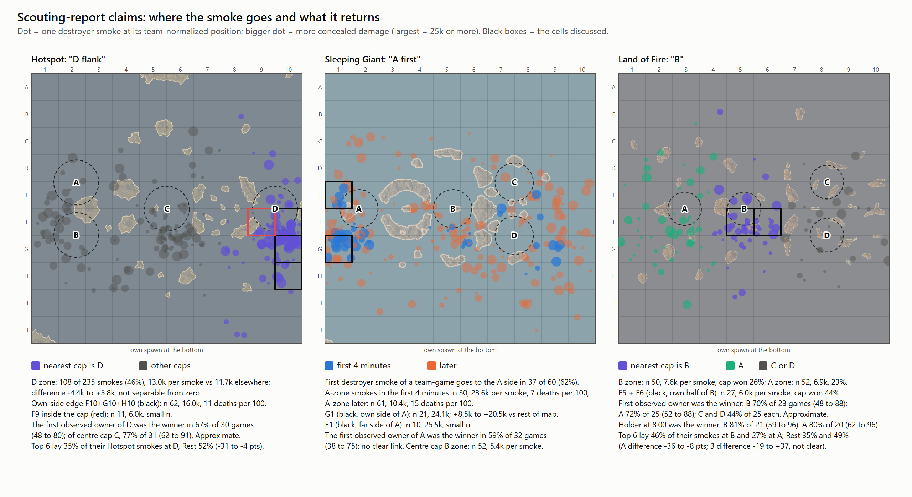

# Module 4: key terrain (what smoke returned, by map and cell)

Batch `output/20261117-122135`, round 4 rerun on the corrected shared loader. Destroyer smokes only: 1,074 smokes, 171 games, 7 maps.

**How to read this.** Positions are team-normalized: the smoking team's spawn is always at the bottom of the map. North-spawn teams are mirrored north-south; on Okinawa (spawns NE and SW) they are mirrored across the NW-SE diagonal, so own spawn is bottom left. A cell such as "G1" means that cell as seen by a team spawning at the bottom. Grid: numbers west to east, letters north to south. "Zone" = every smoke assigned to its nearest cap (my own helper; the batch's "contested cap" names a different cap for 158 of the 1,074 smokes, so I did not use it for location). A cell is rated only with 8+ smokes; 8 to 14 is small n. "High" = concealed damage per smoke at least 1.4x the map average, "low" = at most 0.6x. Intervals are 95%, resampling clans.

**Everything here is association, not cause.** The numbers say what smokes laid in a spot returned and where each group smoked. They do not say that smoking there makes a team win: a cell can read high because good or winning teams happen to smoke there. Cap ownership is approximate: it is only recorded at the moments a smoke is laid, so "first owner" means first observed owner and "holder at 8:00" means the last owner seen before 8:00.

## Findings

**1. Sleeping Giant: smokes in the own-side corner of cap A (G1) returned the most of any cell in the tournament.** G1: 24.1k concealed damage per smoke, n 21 (10 clans, 13 games), +8.5k to +20.5k against the rest of the map. The same is seen in wins (26.5k, n 14) and losses (19.3k, n 7), and for Top 6 (23.2k, n 12) and Rest (25.3k, n 9). These are early smokes (median 2:40 into the game) and 91% of the damage was fired by ships other than the smoker, mostly cruisers. E1 on the far side of A reads the same (25.5k, n 10, small n, interval crosses zero). Top 6 and Rest smoke these cells equally often (17% vs 16% of smokes, -8 to +10 pts).
For a player: on Sleeping Giant, a first smoke for a cruiser just south-west of A in the opening 4 minutes is the spot that returned the most damage. [Sheet](sheet-sleeping-giant.png)

**2. Centre-cap smokes returned little damage on every map that has a centre cap.** Sleeping Giant B zone 5.4k per smoke (n 52, -12.9k to -3.9k vs elsewhere); Hotspot F5 3.9k (n 15, -12.2k to -4.3k) and F6 5.4k (n 17, median 0); Land of Fire F5 4.0k (n 16, -7.3k to -0.2k). Deaths were not higher there (0 to 13 per 100). Some of these spots were followed by a cap capture more often: Hotspot G6 43% (n 14, small n), Land of Fire F6 55% (n 11, small n, 4 clans). Loop F7 inside cap B shows the same pattern: 3.1k, cap won after 53% of smokes (n 15).
For a player: smoke in the middle went with cap captures, not with damage.

**3. Rest teams lay half their smoke at cap A on Loop and on Land of Fire; Top 6 lay about a quarter there.** Loop cap A zone: Rest 50% of their smokes vs Top 6 22% (-49 to -7 pts). It is the lowest-returning zone on the map (4.8k per smoke; cap won after 17% of smokes, -31 to -2 pts vs elsewhere). Observed, approximate: the team seen holding A at 8:00 was the winner in 33% of 18 games (15 to 56); the team seen holding B in 75% of 20 (52 to 94). Land of Fire cap A zone: Rest 49% vs Top 6 27% (-36 to -8 pts); damage there is ordinary (6.9k).
For a player: on Loop, Top 6 smoke B and C more than A, and A smokes returned the least. [Usage figure](usage-top6-vs-rest.png)

**4. Hotspot: Top 6 smoke the west caps, Rest smoke D and the centre.** Top 6 lay 36% of their Hotspot smokes at A and B vs Rest 14% (A +5 to +16 pts, B +2 to +23 pts) and 35% at D vs 52% (-31 to -4 pts). The four low cells (F5, G5, F6, F9; 5.3k per smoke, n 55) take 11% of Top 6 smokes and 30% of Rest smokes (-34 to -5 pts). West zones returned 15.6k (B, n 36) and 19.7k (A, n 14, small n, cap won after 57%). Caution: within the B zone Rest smokes returned more than Top 6 smokes (20.8k vs 10.5k), so the return is not specific to Top 6.
For a player: on Hotspot the west side is where Top 6 smoke more than others, and smokes there returned at least as much as at D.

**5. Pooled across maps, Top 6 are not clearly more often in high cells.** Five high cells (63 smokes): Top 6 7.2% of their smokes, Rest 5.1% (-1.3 to +5.0 pts). Ten low cells (128 smokes): 9.6% vs 13.2% (-8.8 to +2.8 pts). High cells also read high among Rest clans (19.9k vs 9.2k elsewhere) and in losses (13.7k vs 8.3k), but only G1 clears its own interval.
For a player: nothing actionable beyond findings 1 to 4.

**6. Other high cells are small or uneven.** Loop F8 (18.3k, n 15) is 31.4k in wins and 3.4k in losses; Loop F10 (20.7k, n 9, small n) has 33 deaths per 100; Sleeping Giant G9 (22.5k, n 8, small n) is 7 wins of 8. Mountain Range, Sea of Fortune and Okinawa have no rated high or low cell. Mountain Range cap A (the 10 km cap) zone reads 15.5k (n 30) but the median is 4.7k and the interval crosses zero (-1.3k to +13.9k); treat as no finding. Okinawa has the most deaths: 22 per 100 smokes (n 82).
For a player: nothing actionable.

**PN** (10 destroyer smokes, small n): none in a high or low cell; spread over six maps; two smokes above 40k (Okinawa H4, Land of Fire F9), and the smoker died in both.

## Scouting-report claims

The report text was not available. I tested the three phrases Sean named, each in its most natural reading. The earlier scouting report used H-SR, RESIN and PN data only, which is why Hotspot D and Land of Fire B read differently field-wide. [Claims figure](claims-hotspot-sleeping-giant-land-of-fire.png)

| Claim | What I tested | Result (observed, association only) |
|---|---|---|
| Hotspot "D flank" | What smoke nearest D returned; how often the first observed owner of D was the winner | **Not seen as special field-wide.** D takes 46% of smokes (n 108) at 13.0k, no different from elsewhere (-4.4k to +5.8k). The own-side edge F10+G10+H10 returned more (16.0k, n 62, -0.6k to +10.8k); F9 inside the cap is low (6.0k, n 11, small n). The first observed owner of D was the winner in 67% of 30 games (48 to 80); for centre cap C it was 77% of 31 (62 to 91). |
| Sleeping Giant "A first" | Where the first smoke goes; what early A smoke returned; how often the first observed owner of A was the winner | **Seen for smoke, not for the cap.** The first destroyer smoke goes to the A side in 37 of 60 team-games. A-zone smoke in the first 4 minutes returned 23.6k (n 30); later 10.4k (n 61). The first observed owner of A was the winner in 59% of 32 games (38 to 75): no clear link. |
| Land of Fire "B" | How often the team seen holding B was the winner; what smoke at B returned | **Half seen.** The team seen holding B at 8:00 was the winner in 81% of 21 games (59 to 96), and the same holds for A: 80% of 20 (62 to 96). Home caps C and D: 42% and 47%. Smoke at B returned ordinary damage (7.6k, n 50); the cap was won after 44% of F5+F6 smokes (n 27). |

For a player: on Land of Fire the A and B pair, not B alone, went with the winning side; on Hotspot the same is true of C more than D. These are observations from approximate cap records, not proof that taking the cap wins the game.

## Supporting table: rated cells per map (concealed damage per smoke / deaths per 100 / cap won)

| Map (avg) | High or best | Low or worst |
|---|---|---|
| Sleeping Giant (11.9k) | G1 24.1k / 14 / 29% n 21; E1 25.5k / 10 / 40% n 10*; G9 22.5k / 0 / 12% n 8* | G6 3.9k / 0 / 9% n 11*; F6 5.1k / 20 / 30% n 10*; F5 6.7k / 8 / 25% n 12* |
| Hotspot (12.3k) | G6 16.7k / 0 / 43% n 14* (median 2.7k); G10 15.6k / 9 / 31% n 35; F10 14.2k / 14 / 18% n 22 | F5 3.9k / 13 / 20% n 15; F6 5.4k / 0 / 24% n 17; F9 6.0k / 9 / 27% n 11*; G5 6.3k / 0 / 33% n 12* |
| Loop (8.0k) | F10 20.7k / 33 / 44% n 9*; F8 18.3k / 13 / 40% n 15 | F7 3.1k / 0 / 53% n 15; G4 4.8k / 0 / 44% n 9* |
| Mountain Range (10.9k) | G7 11.5k / 15 / 23% n 13*; F4 10.8k / 8 / 42% n 12* | G4 7.6k / 8 / 31% n 13* |
| Land of Fire (7.6k) | F6 8.8k / 18 / 55% n 11* | F5 4.0k / 6 / 38% n 16; F3 5.5k / 18 / 27% n 11* |
| Sea of Fortune (11.6k) | F2 12.0k / 14 / 21% n 14* (only rated cell) | none |
| Okinawa (11.9k) | D1 12.0k / 25 / 25% n 8* (only rated cell) | none |

\* small n (8 to 14). Zone figures and Top 6 vs Rest shares for every cap are printed under each map sheet. Every rated cell and every cap zone is also in `cells.json`.

## Map sheets

Scripts: `m4lib.py` (helpers), `tables.py` (cells, zones, shares; output in `tables-r4.txt`), `hypotheses.py` (claims, cap owners; output in `hypotheses-r4.txt`), `cells_json.py` (writes `cells.json`), `figs.py` (figures). SVG copies sit next to each PNG. Changes from the first run are listed in `CHANGES-R4.md`.
