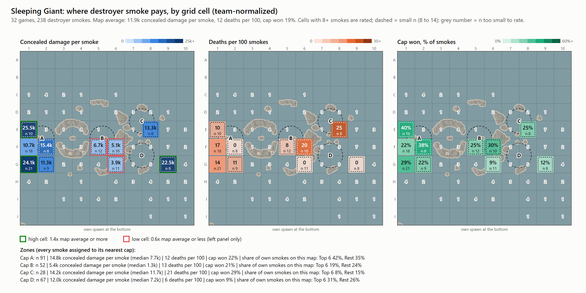
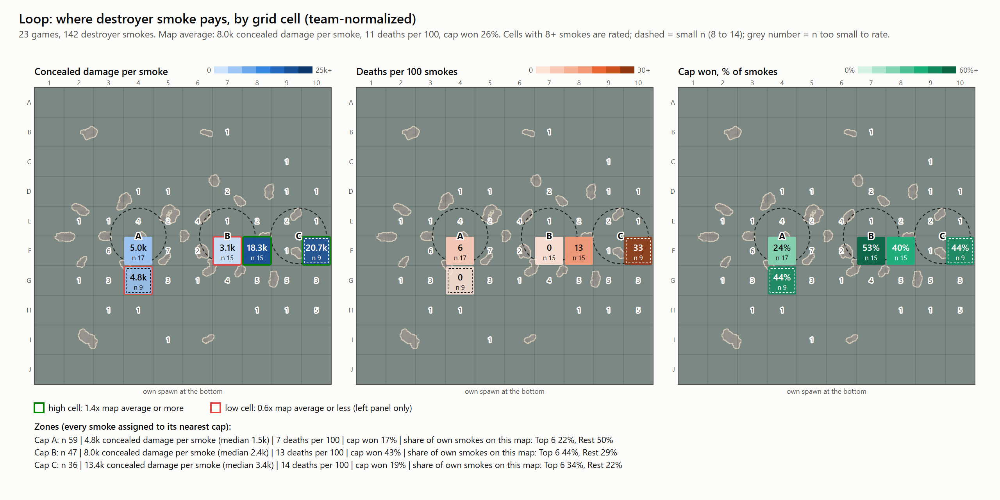
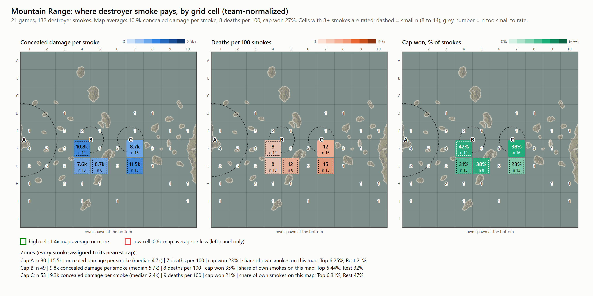
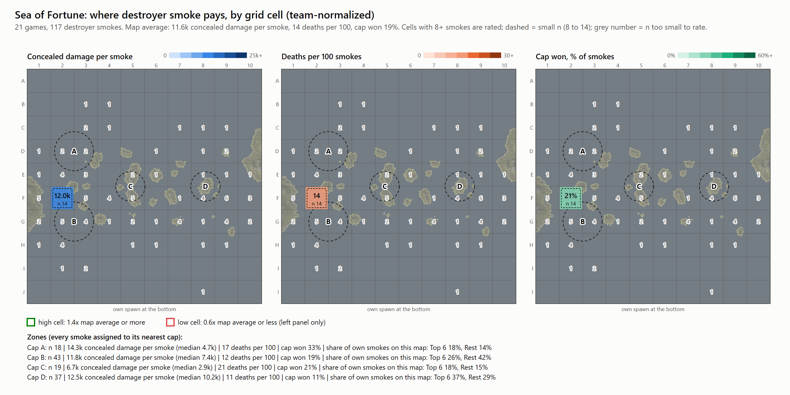
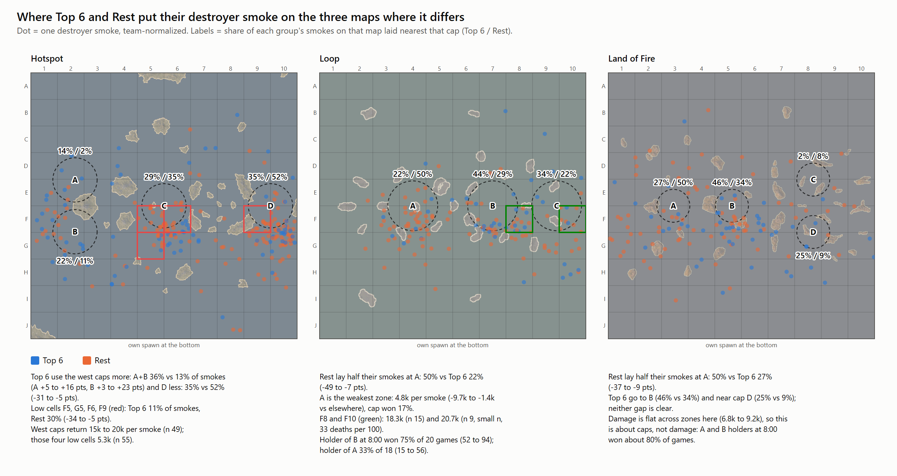

# Module 4: key terrain (where smoke pays, by map)

Batch `output/20261117-122135`. Destroyer smokes only: 1,074 smokes, 171 games, 7 maps.

**How to read this.** Positions are team-normalized: the smoking team's spawn is always at the bottom of the map. North-spawn teams are mirrored north-south; on Okinawa (spawns NE and SW) they are mirrored across the NW-SE diagonal, so own spawn is bottom left. A cell such as "G1" means that cell as seen by a team spawning at the bottom. Grid: numbers west to east, letters north to south. "Zone" = every smoke assigned to its nearest cap (my own helper; the batch's "contested cap" names a different cap for 159 of the 1,074 smokes, so I did not use it for location). A cell is rated only with 8+ smokes; 8 to 14 is small n. "High" = concealed damage per smoke at least 1.4x the map average, "low" = at most 0.6x. Intervals are 95%, resampling clans. Everything here is association, not cause: a cell can look good because good or winning teams smoke there. Cap ownership comes from snapshots taken only when a smoke is laid, so "first owner" means first observed owner.

## Findings

**1. Sleeping Giant: the own-side corner of cap A (G1) is the best-paying cell in the tournament.** G1: 24.1k concealed damage per smoke, n 21 (10 clans, 13 games), +8.5k to +20.5k against the rest of the map. It holds in wins (26.5k, n 14) and losses (19.3k, n 7), and for Top 6 (23.2k, n 12) and Rest (25.3k, n 9), so it is not just good teams. It is an early play (median 2:40 into the game) and 91% of the damage is fired by ships other than the smoker, mostly cruisers. E1 on the far side of A looks the same (25.5k, n 10, small n, interval crosses zero). Top 6 and Rest use these cells equally (17% vs 16% of smokes, -8 to +10 pts).
For a player: on Sleeping Giant, lay the first smoke for your cruiser just south-west of A in the opening 4 minutes. [Sheet](sheet-sleeping-giant.png)

**2. Centre-cap smoke buys little damage on every map that has a centre cap.** Sleeping Giant B zone 5.4k per smoke (n 52, -12.9k to -3.9k vs elsewhere); Hotspot F5 3.9k (n 15, -12.2k to -4.3k) and F6 5.4k (n 17, median 0); Land of Fire F5 4.0k (n 16, -7.3k to -0.2k). Deaths are not higher there (0 to 13 per 100). Some of these do win caps: Hotspot G6 43% (n 14, small n), Land of Fire F6 55% (n 11, small n, 4 clans). Loop F7 inside cap B is the same pattern: 3.1k but cap won 53% (n 15).
For a player: smoke in the middle is for taking the cap, not for damage. If the cap is not on offer, the smoke is better spent on a flank.

**3. Rest teams put half their smoke where it pays least on Loop and Land of Fire.** Loop cap A zone: Rest 50% of their smokes vs Top 6 22% (-49 to -7 pts). It is the weakest zone on the map (4.8k per smoke, cap won 17%, -31 to -2 pts vs elsewhere), and the team holding A at 8:00 won only 33% of 18 games (15 to 56), against 75% of 20 (52 to 94) for the holder of B. Land of Fire cap A zone: Rest 50% vs Top 6 27% (-37 to -9 pts); damage there is ordinary (6.8k).
For a player: on Loop, do not pour smoke into A; B is the cap tied to winning. [Usage figure](usage-top6-vs-rest.png)

**4. Hotspot: Top 6 smoke the west caps, Rest crowd D and the centre.** Top 6 lay 36% of their Hotspot smokes at A and B vs Rest 13% (A +5 to +16 pts, B +3 to +23 pts) and 35% at D vs 52% (-31 to -5 pts). The four low cells (F5, G5, F6, F9; 5.3k per smoke, n 55) take 11% of Top 6 smokes and 30% of Rest smokes (-34 to -5 pts). West zones return 15.1k (B, n 35) and 19.7k (A, n 14, small n, cap won 57%). Caution: within the west zone Rest earn more than Top 6 (20.0k vs 10.5k at B), so the damage is not a Top 6 effect.
For a player: on Hotspot the west side is under-used by most teams and pays at least as well as D.

**5. Pooled across maps, Top 6 are not clearly more often in high cells.** Five high cells (63 smokes): Top 6 7.2% of their smokes, Rest 5.1% (-1.3 to +5.0 pts). Ten low cells (128 smokes): 9.6% vs 13.2% (-8.8 to +2.8 pts). High cells stay high among Rest clans (19.9k vs 9.2k elsewhere) and in losses (13.7k vs 8.3k), so they are not only a winner effect, but only G1 clears its own interval.
For a player: nothing actionable beyond findings 1 to 4.

**6. Other high cells are small or confounded.** Loop F8 (18.3k, n 15) is 31.4k in wins and 3.4k in losses; Loop F10 (20.7k, n 9, small n) costs 33 deaths per 100; Sleeping Giant G9 (22.5k, n 8, small n) is 7 wins of 8. Mountain Range, Sea of Fortune and Okinawa have no rated high or low cell. Mountain Range cap A (the 10 km cap) zone reads 15.5k (n 30) but the median is 4.7k and the interval crosses zero (-1.3k to +13.9k); treat as no finding. Okinawa is the costliest map: 22 deaths per 100 smokes (n 82).
For a player: nothing actionable.

**PN** (10 destroyer smokes, small n): none in a high or low cell; spread over six maps; two smokes above 40k (Okinawa H4, Land of Fire F9), both cost the smoker's life.

## Scouting-report claims

The report text was not available. I tested the three phrases Sean named, each in its most natural reading. [Claims figure](claims-hotspot-sleeping-giant-land-of-fire.png)

| Claim | What I tested | Result |
|---|---|---|
| Hotspot "D flank" | Does smoke nearest D pay more; does taking D go with winning | **Not confirmed as special.** D takes 46% of smokes (n 109) at 13.2k, no different from elsewhere (-4.3k to +6.4k). The own-side edge F10+G10+H10 is better (16.3k, n 63, -0.1k to +11.1k); F9 inside the cap is low (6.0k, n 11). First observed owner of D won 67% of 30 games (48 to 80); centre cap C is the stronger signal, 77% of 31 (62 to 91). |
| Sleeping Giant "A first" | Where the first smoke goes; value of early A smoke; does owning A go with winning | **Confirmed for smoke, not for the cap.** First destroyer smoke goes to the A side in 37 of 60 team-games. A-zone smoke in the first 4 minutes: 23.6k, n 30; later: 10.4k, n 61. First observed owner of A won 59% of 32 (38 to 75), not separable from a coin flip. |
| Land of Fire "B" | Is B the cap tied to winning; is B where smoke pays | **Half confirmed.** Holder of B at 8:00 won 81% of 21 (60 to 96), but A is the same: 80% of 20 (62 to 95). Home caps C and D: 42% and 47%. Smoke at B does not pay in damage (7.7k, n 49) but F5+F6 win the cap 44% of the time (n 27). |

For a player: Land of Fire is decided on the A and B pair, not B alone; on Hotspot look at C before D.

## Supporting table: rated cells per map (concealed damage per smoke / deaths per 100 / cap won)

| Map (avg) | High or best | Low or worst |
|---|---|---|
| Sleeping Giant (11.9k) | G1 24.1k / 14 / 29% n 21; E1 25.5k / 10 / 40% n 10*; G9 22.5k / 0 / 12% n 8* | G6 3.9k / 0 / 9% n 11*; F6 5.1k / 20 / 30% n 10*; F5 6.7k / 8 / 25% n 12* |
| Hotspot (12.3k) | G6 16.7k / 0 / 43% n 14* (median 2.7k); G10 15.6k / 9 / 31% n 35; F10 15.1k / 13 / 17% n 23 | F5 3.9k / 13 / 20% n 15; F6 5.4k / 0 / 24% n 17; F9 6.0k / 9 / 27% n 11*; G5 6.3k / 0 / 33% n 12* |
| Loop (8.0k) | F10 20.7k / 33 / 44% n 9*; F8 18.3k / 13 / 40% n 15 | F7 3.1k / 0 / 53% n 15; G4 4.8k / 0 / 44% n 9* |
| Mountain Range (10.9k) | G7 11.5k / 15 / 23% n 13*; F4 10.8k / 8 / 42% n 12* | G4 7.6k / 8 / 31% n 13* |
| Land of Fire (7.6k) | F6 8.8k / 18 / 55% n 11* | F5 4.0k / 6 / 38% n 16 |
| Sea of Fortune (11.6k) | F2 12.0k / 14 / 21% n 14* (only rated cell) | none |
| Okinawa (11.9k) | D1 12.0k / 25 / 25% n 8* (only rated cell) | none |

\* small n (8 to 14). Zone figures and Top 6 vs Rest shares for every cap are printed under each map sheet.

## Map sheets

Scripts: `m4lib.py` (helpers), `tables.py` (cells, zones, shares), `hypotheses.py` (claims, cap owners), `figs.py` (figures). SVG copies sit next to each PNG.
