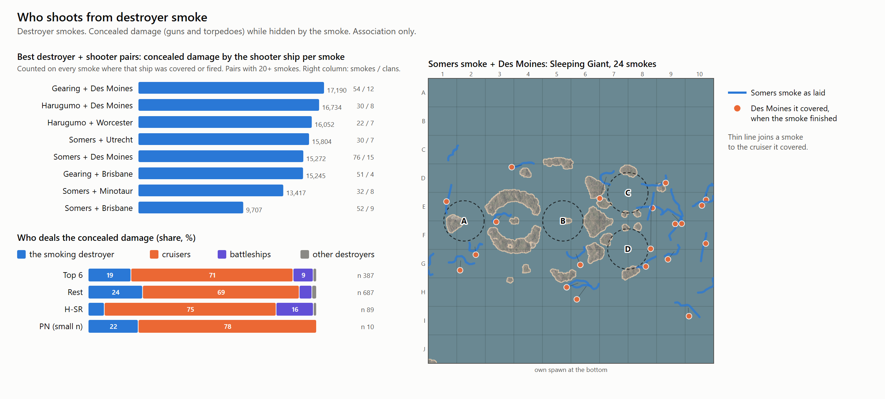
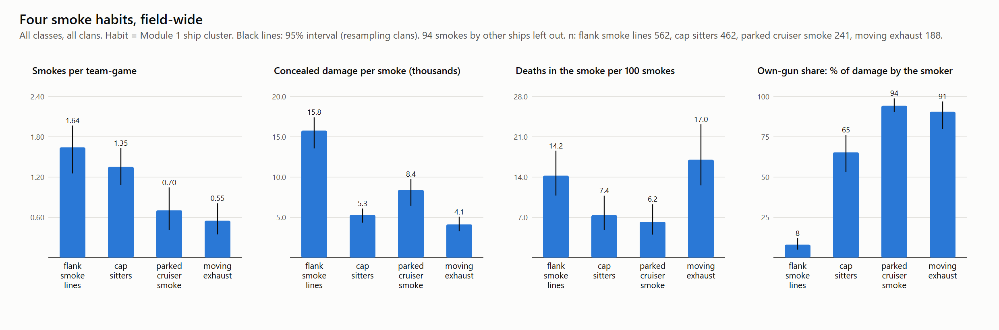
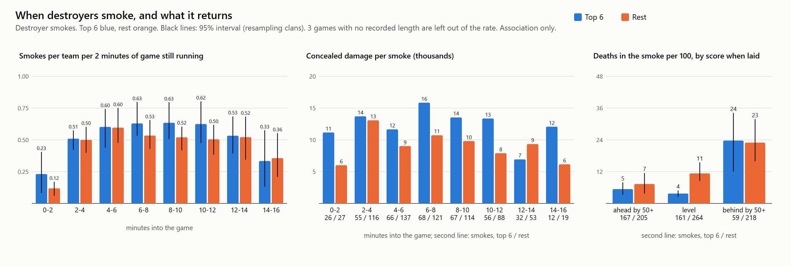
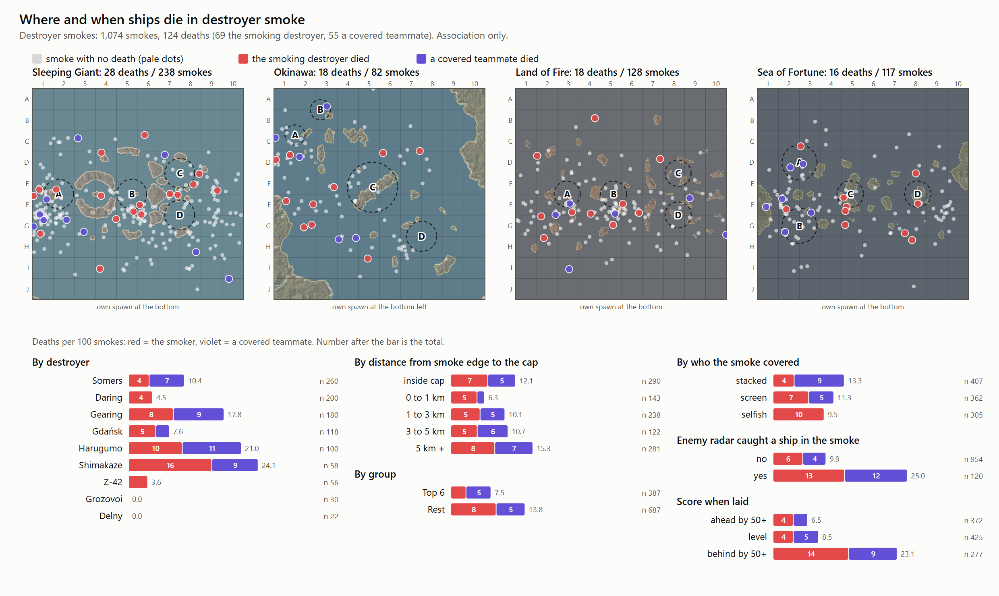
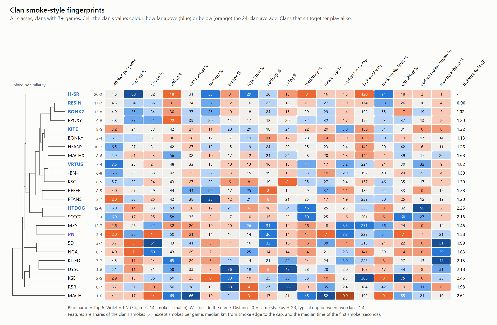
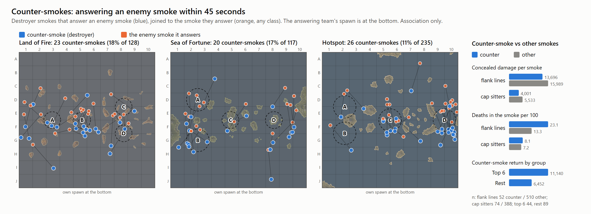

# Module 5: miscellaneous observations

Batch `output/20261117-122135` (1,547 smokes, 171 games). Destroyer smokes (1,074) unless a section says "all classes". Top 6 = H-SR, RESIN, BONKZ, HTDOG, KITE, VRTUS; Rest = everyone else (REEEE and MZY included). "Concealed damage" is damage dealt while hidden by the smoke, torpedoes included.

How to read the maps: positions are team-normalized, so the smoking team's spawn is always at the bottom. North-spawn teams are mirrored north-south; on Okinawa (spawns NE and SW) they are mirrored across the NW-SE diagonal, so own spawn is bottom left.

Intervals are 95%, made by resampling whole clans. A star-worthy result is one whose interval does not cross zero. Everything here is association, not cause: good teams, good ships and good situations travel together.

## 1. Who shoots from the smoke: it is the cruisers, and Des Moines above all

- The best pairs (smoker ship + shooter ship, 20+ smokes, shooter's concealed damage per smoke where that ship was covered or fired): Gearing + Des Moines 17.2k (n 54, 12 clans, interval 11.3k to 23.3k), Harugumo + Des Moines 16.7k (n 30), Harugumo + Worcester 16.1k (n 22), Somers + Utrecht 15.8k (n 30), Somers + Des Moines 15.3k (n 76, 15 clans). Somers + Brisbane is the weak one at 9.7k (n 52). Intervals overlap for the top seven, so read it as "Des Moines, Worcester, Utrecht and Minotaur all pay; Brisbane behind a Somers pays less". Gearing + Brisbane (15.2k) comes from only 4 clans.
- Shooter class share of concealed damage: Top 6 are 71% cruisers, 19% the smoking destroyer, 9% battleships. Rest are 68% / 24% / 5%. The cruiser gap is not reliable (top minus rest +3 points, interval -6.5 to +12.4).
- H-SR now: 75% cruiser damage (unchanged from the earlier round), 16% battleship, only 7% from the destroyer's own guns (n 89 smokes). H-SR's destroyers smoke for others more purely than anyone else in the top group. HTDOG is the opposite (41% cruiser, 56% own guns).
- PN (small n, 10 destroyer smokes): 78% cruiser, 22% own guns, no battleship damage.
- Map view: Somers smokes that covered a Des Moines on Sleeping Giant (24 smokes). They sit on the flanks next to caps A, C and D, and the cruiser is typically inside the smoke (21 of 24), about 1.3 km from its centre.

For a player: if you are the destroyer, the smoke that pays is the one a Des Moines (or Worcester, Utrecht, Minotaur) is sitting in. Lay it where your cruiser already is or is heading, not where you are.

## 2. Smoke-type lens (all classes): long destroyer smoke is the team tool, everything else is a personal tool

| Kind | n | Per team-game | Concealed dmg per smoke | Deaths per 100 | Own-gun share |
|---|---|---|---|---|---|
| Long DD (Somers, Gearing, Gdansk, Harugumo...) | 802 | 2.35 | 13.1k (11.2k to 14.6k) | 14.0 (10.9 to 17.9) | 16% |
| Short DD (Daring, Z-42) | 256 | 0.75 | 3.7k (3.1k to 4.4k) | 4.3 (2.2 to 7.3) | 78% |
| Cruiser smoke (mostly Svea) | 271 | 0.79 | 8.9k (6.9k to 10.0k) | 7.4 (5.0 to 10.4) | 95% |
| Exhaust (mostly Napoli) | 215 | 0.63 | 4.7k (3.9k to 5.6k) | 15.8 (11.8 to 20.6) | 91% |

- Long destroyer smoke returns 3.5 times the short kind (difference +7.3k to +11.0k) but costs more lives (difference +5.6 to +14.0 deaths per 100). It is shared: only 16% of its damage is the smoker's own.
- Short destroyer smoke is safe and nearly private: 78% own guns, 43% of them produce no concealed damage at all.
- Exhaust smoke is the worst trade: low return (4.7k) with the highest death rate (15.8 per 100). It is used while already under pressure, so this is not proof the smoke is bad.
- Within "long DD" ships differ a lot: Harugumo 18.4k and 21 deaths per 100 (n 100), Gearing 16.3k and 17.8, Somers 14.5k and 10.4, Gdansk 8.2k and 7.6, Shimakaze 5.6k and 24.1 (n 58).

For a player: a Somers smoke gives nearly Gearing-level return at a much lower death rate. Do not expect a Daring or Z-42 smoke to feed teammates; treat it as your own cover.

## 3. Timing: same tempo, but the top 6 start earlier and do not die when the game is level

- Rate: both groups lay about 0.5 to 0.6 destroyer smokes per team per 2 minutes from minute 2 to minute 14. The only visible gap is the opening: Top 6 0.23 vs Rest 0.12 in the first 2 minutes (interval -0.04 to +0.29, so suggestive only). Median first destroyer smoke: 170 s vs 209 s.
- Return per smoke is higher for the Top 6 in most bins (for example 15.8k vs 10.8k at 6 to 8 minutes), but no single bin is reliable on its own (8 to 12 minutes: -0.3k to +8.2k).
- Score state matters more than the clock. All clans, deaths per 100 smokes: ahead by 50+ 6.5 (n 372), level 8.5 (n 425), behind by 50+ 23.1 (n 277). Ahead minus behind after minute 4: -24.0 to -10.2 deaths per 100, and +0.5k to +5.5k return.
- Top 6 vs Rest when level: 3.7 vs 11.4 deaths per 100 (n 161 / 264, interval -12.0 to -4.4). When behind both lose a ship in almost one smoke in four (23.7 vs 22.9).
- The Top 6 lay only 15% of their destroyer smokes while behind, the Rest 32%. That mostly reflects winning more.
- PN (small n, 10 smokes): none before 2:37; 4 of 10 laid while behind.

No map: this is a rate finding.

For a player: a smoke laid while 50+ points behind is the dangerous one (about 1 in 4 costs a ship). If you are level, the top teams show it can be done almost for free; the difference is at level score, not when chasing.

## 4. Survival: radar, the ship, and being behind are what kill; distance to the cap is not

- 124 deaths in 1,074 destroyer smokes (11.5 per 100). 69 were the smoking destroyer, 55 a covered teammate (48 of those 55 were cruisers, Des Moines 11).
- Radar: when enemy radar caught a ship in the smoke the rate is 25.0 per 100 (n 120) vs 9.9 without (n 954); difference +6.4 to +27.2.
- Ship: Shimakaze 24.1 (n 58), Harugumo 21.0 (n 100), Gearing 17.8 (n 180), Somers 10.4, Gdansk 7.6, Daring 4.5, Z-42 3.6, Grozovoi 0 of 30, Delny 0 of 22.
- Who dies depends on coverage: in stacked smokes it is the teammate (9.3 teammate vs 3.9 smoker per 100, n 407); in selfish smokes it is the smoker (9.5, n 305).
- Distance band is flat: inside the cap 12.1, 0 to 1 km 6.3, 1 to 3 km 10.1, 3 to 5 km 10.7, 5 km+ 15.3. Inside vs 3 km+: -7.9 to +4.6, no reliable difference. Mountain Range cap A smokes (n 31, 6.5 per 100) do not drive this.
- Top 6 lose 7.5 per 100, Rest 13.8 (difference -10.9 to -2.6). The gap is entirely the smoker surviving (2.8 vs 8.4); teammates die at the same rate (4.7 vs 5.4).
- Map view: deaths are spread along the same contact line as the smokes, not in one trap spot. Okinawa is the most dangerous map (22 per 100, n 82); Sleeping Giant's deaths cluster on the west flank around cap A (cells F1, G1) and between B and D.
- PN (small n): 3 deaths in 10 destroyer smokes.

For a player: count enemy radars before you sit in a smoke, especially in a Gearing, Harugumo or Shimakaze. If you stack a cruiser into your smoke you are spending the cruiser's safety, not yours. The top teams' edge is that their destroyer leaves the smoke alive.

## 5. Clan fingerprints (all classes, 24 clans with 7+ games)

Method: 18 style features per clan (smokes per game, stacked / screen / selfish share, purpose mix, movement mix, share inside a cap, median distance to cap, first-smoke time, smoke-type mix), standardized, then simple average-linkage clustering.

- H-SR is its own branch. It is the extreme on: stacked 50% (average 25%), selfish 18% (average 46%), damage-tagged 35%, reposition 29%, stationary 8%, first smoke at 120 s (earliest), 89% long destroyer smoke.
- Who plays like H-SR: RESIN (distance 0.90) and BONKZ (1.04), stable when any one feature is dropped (both stay in the nearest three 18 times out of 18). Next are BONKY, HFANS, EPOXY and PFANS (1.2 to 1.3). The typical gap between two clans is 1.4.
- The Top 6 are not one style. HTDOG (2.27) and VRTUS (1.88) are far from H-SR: they lean on cruiser smoke (55% and 35% of their smokes), selfish and stationary. KITE sits in between (1.39).
- Across the 23 other clans, being closer to H-SR's style goes with a higher win rate (correlation -0.48, interval -0.75 to -0.13). Association only, and part of it is ship choice.
- PN (small n: 7 games, 14 smokes): pairs with MZY (distance 1.04). Few smokes (2.0 per game), laid far from caps (median 3.8 km), pushing 36%, stacked 36%. Distance to H-SR 1.57, so mid-field, not an H-SR lookalike.

No map: this is a style finding.

For a player: the H-SR, RESIN, BONKZ recipe is "long destroyer smoke, early, with a teammate in it, rarely for yourself". HTDOG and VRTUS win with a different recipe built on cruiser smoke, so the H-SR style is not the only one that works.

## 6. Counter-smoke and chains

- 133 destroyer smokes (12%) answer an enemy smoke within 45 s (median 17 s later, 73% at the same cap, about 9 km away, so across the fight rather than on top of it). Top 6 11%, Rest 13% (difference -6.9 to +4.7: no difference in how often).
- They return less. Long destroyer smoke: 10.2k as a counter (n 86) vs 13.4k otherwise (n 716), difference -6.4k to -0.2k. Deaths 18.6 vs 13.4 per 100 (interval -5.5 to +17.3, not reliable). Short destroyer smoke shows no difference (3.3k vs 3.8k).
- Head to head, the counter-smoke out-damages the smoke it answers only 38% of the time (interval 31% to 43%). Answering second is answering from behind.
- Top 6 counter-smokes return 11.1k vs Rest 6.5k (n 44 / 89, interval -0.1k to +8.7k, borderline).
- Map view: counter-smokes are most common on Land of Fire (18% of destroyer smokes) and Sea of Fortune (17%), and sit on the own side of the caps (80% or more in the own half), facing the answered smoke across the cap line.
- PN (small n): 2 counter-smokes.
- Chains (same-team smokes laid within 1 km and 60 s of each other): dropped as a finding. Only 16 pairs in 171 games, none by the same player, mostly a destroyer plus a cruiser (HTDOG 5, VRTUS 3, HFANS 3). Too few to compare outcomes (interval on return -8.8k to +6.9k).

For a player: a reflex smoke in reply to theirs is a below-average smoke. If you answer, answer with a shooter already in position; otherwise keep the charge.

## Notes on the data

- 3 smoke ids appear twice (in different games), and the shared library matches detail records by id alone, so up to 3 of 1,547 smokes may carry another smoke's detail. Too few to move any number here.
- 27 of the 124 destroyer-smoke deaths are flagged as happening after the smoke had cleared; they are counted as deaths in the smoke, as the batch does.
- Score-state rates could not be normalized by time spent in each state (the batch has no continuous score timeline), so section 3 reports outcomes per smoke by state, not smokes per minute by state.

Scripts: `m5_figs.py` (figures), `m5_numbers.py` and `m5_numbers2.py` (tables), `m5_cluster.py` (features, clustering, chains), `m5lib.py` (helpers).
