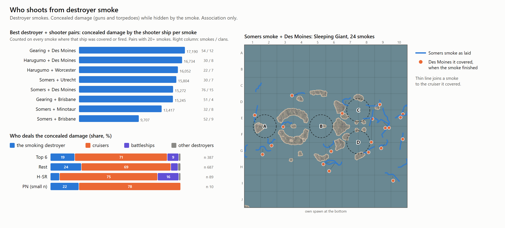
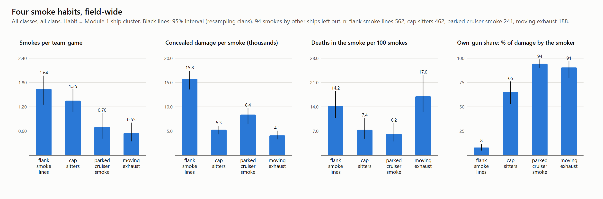
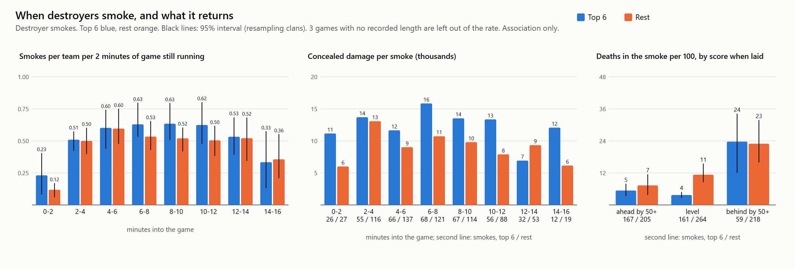
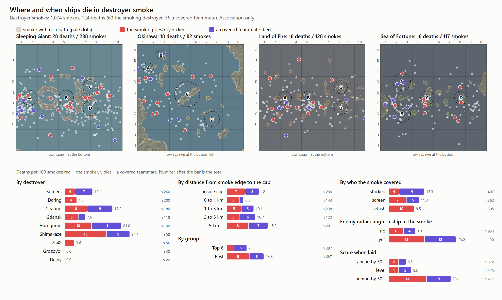
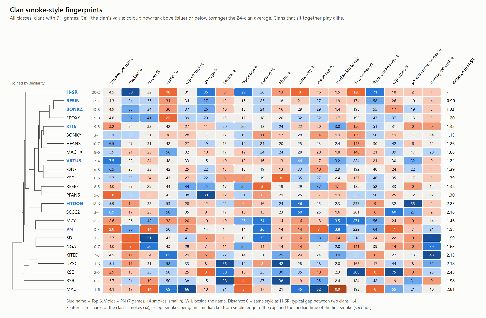
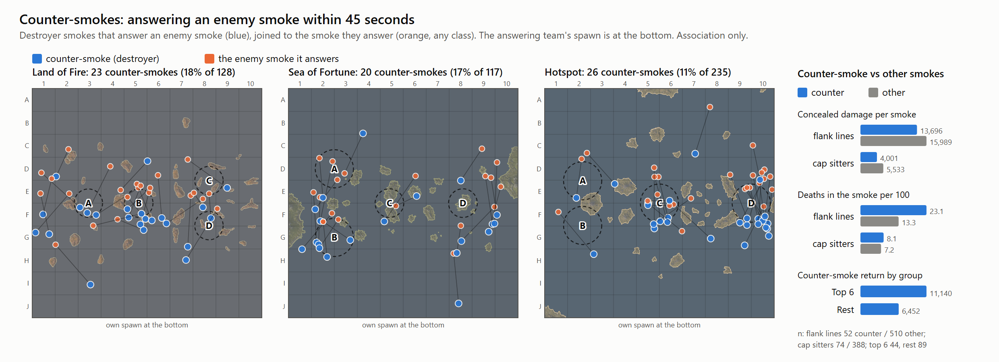

# Module 5: miscellaneous observations (round 4 revision)

Batch `output/20261117-122135` (1,547 smokes, 171 games). Destroyer smokes (1,074) unless a section says "all classes". Top 6 = H-SR, RESIN, BONKZ, HTDOG, KITE, VRTUS; Rest = everyone else (REEEE and MZY included). "Concealed damage" is damage dealt while hidden by the smoke, torpedoes included.

Smoke types are Module 1's four habit clusters: **flank smoke lines** (Somers, Gearing, Harugumo, Delny), **cap sitters** (Daring, Z-42, Gdansk, Grozovoi, Shimakaze), **parked cruiser smoke** (Svea, Jinan), **moving exhaust** (Napoli, Venezia, C. Colombo). Smokes by any other ship are "other" and are left out of habit splits.

How to read the maps: positions are team-normalized, so the smoking team's spawn is always at the bottom. North-spawn teams are mirrored north-south; on Okinawa (spawns NE and SW) they are mirrored across the NW-SE diagonal, so own spawn is bottom left.

Intervals are 95%, made by resampling whole clans. A difference is called reliable only when its interval does not cross zero. Everything here is association, not cause: this describes what was done, where, and what came back from it. It does not show that any of it produces wins.

## 1. Who shoots from the smoke: cruisers, and Des Moines most of all

- Pairs (smoker ship + shooter ship, 20+ smokes, the shooter ship's concealed damage per smoke where that ship was covered or fired): Gearing + Des Moines 17.2k (n 54, 12 clans, interval 11.3k to 23.3k), Harugumo + Des Moines 16.7k (n 30), Harugumo + Worcester 16.1k (n 22), Somers + Utrecht 15.8k (n 30), Somers + Des Moines 15.3k (n 76, 15 clans). Somers + Brisbane is lowest at 9.7k (n 52). Intervals overlap for the top seven: Des Moines, Worcester, Utrecht and Minotaur all returned well from flank smoke lines; Brisbane behind a Somers returned less. Gearing + Brisbane (15.2k) comes from only 4 clans.
- Shooter class share of concealed damage: Top 6 are 71% cruisers, 19% the smoking destroyer, 9% battleships. Rest are 69% / 24% / 6%. The cruiser gap is not reliable (+2 points, interval -7.7 to +11.3).
- H-SR now: 75% cruiser damage (same as the earlier round), 16% battleship, 7% from the destroyer's own guns (n 89). H-SR's destroyer smokes are used by other ships more than any other Top 6 clan's. HTDOG is the opposite (41% cruiser, 56% own guns).
- PN (small n, 10 destroyer smokes): 78% cruiser, 22% own guns, no battleship damage.
- Map view: Somers smokes that covered a Des Moines on Sleeping Giant (24 smokes). They lie on the flanks beside caps A, C and D. The cruiser was inside the smoke in 21 of 24, about 1.3 km from its centre.

For a player: the flank smoke lines that returned most had a Des Moines (or Worcester, Utrecht, Minotaur) sitting in them. The Somers smokes on Sleeping Giant were laid where the cruiser was, beside A, C and D.

## 2. Smoke-type lens on the four habits (all classes)

94 of the 1,547 smokes are by ships outside the four habits (Smolensk 14, Cerberus 13, Fuyutsuki 10, Z-52 10, Conte Verde 9, others) and are left out. 342 team-games.

| Habit | n | Smokes per team-game | Concealed dmg per smoke | Deaths per 100 | Own-gun share |
|---|---|---|---|---|---|
| Flank smoke lines | 562 | 1.64 (1.26 to 1.97) | 15.8k (13.6k to 17.4k) | 14.2 (10.7 to 18.5) | 8% (5 to 13) |
| Cap sitters | 462 | 1.35 (1.10 to 1.62) | 5.3k (4.4k to 6.1k) | 7.4 (4.9 to 10.8) | 65% (52 to 77) |
| Parked cruiser smoke | 241 | 0.70 (0.43 to 1.07) | 8.4k (6.1k to 9.7k) | 6.2 (3.9 to 9.4) | 94% (90 to 99) |
| Moving exhaust | 188 | 0.55 (0.36 to 0.79) | 4.1k (3.3k to 5.1k) | 17.0 (12.7 to 22.8) | 91% (81 to 97) |

Own-gun share = share of the smoke's concealed damage dealt by the smoker itself.

- Flank smoke lines returned about three times a cap sitter smoke (difference +8.5k to +12.4k) and had more deaths in them (difference +2.9 to +11.3 per 100). They are shared smokes: 8% own guns, 11% selfish.
- Cap sitter smokes were mostly for the destroyer itself: 65% own guns, 49% selfish, and 37% produced no concealed damage.
- Parked cruiser smoke sits in between on return (8.4k, flank lines minus parked: +4.5k to +10.2k) with the lowest death rate (6.2).
- Moving exhaust had the lowest return (4.1k; half produced no concealed damage) and the highest death rate (17.0). Its death rate is not reliably different from flank smoke lines (-10.0 to +3.6). Exhaust is used while already under fire.
- Ships within a habit differ. Flank smoke lines: Harugumo 18.4k and 21.0 deaths per 100 (n 100), Gearing 16.3k and 17.8 (n 180), Somers 14.5k and 10.4 (n 260), Delny 14.5k and 0 (n 22). Cap sitters: Gdansk 8.2k and 7.6 (n 118), Grozovoi 6.5k and 0 (n 30), Shimakaze 5.6k and 24.1 (n 58), Z-42 4.1k and 3.6 (n 56), Daring 3.6k and 4.5 (n 200).

No map: this is a rate finding.

For a player: flank smoke lines were the smokes teammates shot from; cap sitter, cruiser and exhaust smokes were used almost entirely by the ship that laid them.

## 3. Timing: same tempo; Top 6 start earlier and lose fewer ships at level score

- Rate: both groups lay about 0.5 to 0.6 destroyer smokes per team per 2 minutes from minute 2 to minute 14. The only visible gap is the opening: Top 6 0.23 vs Rest 0.12 in the first 2 minutes (interval -0.06 to +0.28, suggestive only). Median first destroyer smoke: 170 s vs 209 s.
- Return per smoke is higher for the Top 6 in most bins (for example 15.8k vs 10.8k at 6 to 8 minutes), but no single bin is reliable on its own (8 to 12 minutes: -0.1k to +8.1k).
- Score state goes with outcomes more than the clock does. All clans, deaths per 100 smokes: ahead by 50+ 6.5 (n 372), level 8.5 (n 425), behind by 50+ 23.1 (n 277). Ahead minus behind after minute 4: -24.8 to -10.5 deaths per 100, and +0.7k to +5.5k return.
- Top 6 vs Rest when level: 3.7 vs 11.4 deaths per 100 (n 161 / 264, interval -11.6 to -4.5). When behind, both lose a ship in almost one smoke in four (23.7 vs 22.9).
- Top 6 lay 15% of their destroyer smokes while behind, Rest 32%. Top 6 are behind less often, so this mostly mirrors the scoreboard.
- PN (small n, 10 smokes): none before 2:37; 4 of 10 laid while behind.

No map: this is a rate finding.

For a player: smokes laid while 50+ points behind had a death in them about 1 time in 4, for every group. At level score Top 6 smokes had a death in them about 1 time in 27, Rest about 1 in 9.

## 4. Survival: deaths in smoke go with radar, the ship and the score; not with distance to the cap

- 124 deaths in 1,074 destroyer smokes (11.5 per 100). 69 were the smoking destroyer, 55 a covered teammate (48 of those 55 were cruisers, Des Moines 11).
- Radar: when enemy radar caught a ship in the smoke the rate was 25.0 per 100 (n 120) vs 9.9 without (n 954); difference +6.9 to +27.5.
- Habit: flank smoke lines 14.2 per 100 (n 562; 6.2 the smoker, 8.0 a teammate) vs cap sitters 7.4 (n 462; 5.6 the smoker, 1.7 a teammate); difference +2.9 to +11.2. The extra deaths in flank smoke lines are teammates. 50 destroyer smokes by other ships are left out.
- Ship: Shimakaze 24.1 (n 58), Harugumo 21.0 (n 100), Gearing 17.8 (n 180), Somers 10.4 (n 260), Gdansk 7.6, Daring 4.5, Z-42 3.6, Grozovoi 0 of 30, Delny 0 of 22.
- **Somers vs Gearing** (same habit, same 30 s smoke): concealed damage per smoke 14.5k (n 260, 18 clans) vs 16.3k (n 180, 16 clans), difference -1.8k, interval -5.4k to +3.4k, not reliable. Deaths per 100 smokes 10.4 vs 17.8, difference -7.4, interval -16.5 to -0.6, reliable but close to zero at the upper end. So Somers smokes returned about the same and had fewer deaths in them. 8 clans used both ships; stacked share is similar (57% vs 52%).
- Who dies follows coverage: in stacked smokes it is the teammate (9.3 teammate vs 3.9 smoker per 100, n 407); in selfish smokes it is the smoker (9.5, n 305).
- Distance band is flat: inside the cap 12.1, 0 to 1 km 6.3, 1 to 3 km 10.1, 3 to 5 km 10.7, 5 km+ 15.3. Inside vs 3 km+: -7.6 to +4.5, no reliable difference. Mountain Range cap A smokes (n 31, 6.5 per 100) do not drive this.
- Top 6 lose 7.5 per 100, Rest 13.8 (difference -11.0 to -2.1). The gap is all in the smoker (2.8 vs 8.4); teammates die at the same rate (4.7 vs 5.4).
- Map view: deaths lie along the same contact line as the smokes, not in one spot. Okinawa has the highest rate (22 per 100, n 82). On Sleeping Giant deaths cluster on the west flank around cap A (cells F1, G1) and between B and D.
- PN (small n): 3 deaths in 10 destroyer smokes.

For a player: smokes that enemy radar reached had 2.5 times the deaths. In a stacked smoke the ship lost was usually the covered cruiser, not the destroyer. Somers smokes had fewer deaths than Gearing smokes at about the same return.

## 5. Clan fingerprints (all classes, 24 clans with 7+ games)

Method: 18 style features per clan (smokes per game, stacked / screen / selfish share, purpose mix, movement mix, share inside a cap, median distance to cap, first-smoke time, share of smokes in each of the four habits), standardized, then simple average-linkage clustering. Values, distances and branches are saved in `clan-styles.json`.

- H-SR is the extreme clan on: stacked 50% (24-clan average 25%), selfish 18% (average 45%), damage-tagged 35%, reposition 29%, stationary 8%, first smoke at 120 s (earliest), 71% flank smoke lines (average 36%), 1% moving exhaust.
- Who plays like H-SR: RESIN (distance 0.90), BONKZ (1.02) and BONKY (1.13). All three stay in H-SR's nearest three whichever single feature is dropped (18 of 18). Next are EPOXY (1.20), HFANS (1.26), PFANS (1.30), KITE (1.32). The typical gap between two clans is 1.4.
- On the habit features H-SR joins the main branch (15 clans) rather than standing alone; it is still the most extreme member of it.
- The Top 6 are not one style. HTDOG (2.25) and VRTUS (1.82) are far from H-SR: parked cruiser smoke is 55% and 32% of their smokes, flank smoke lines 9% and 21%, and they are high on selfish and stationary.
- Across the 23 other clans, a style closer to H-SR's goes with a higher win rate (correlation -0.51, interval -0.78 to -0.17). Association only, and part of it is ship choice.
- PN (small n: 7 games, 14 smokes): pairs with MZY (distance 1.06). Few smokes (2.0 per game), laid far from caps (median 3.8 km), pushing 36%, stacked 36%, 64% flank smoke lines. Distance to H-SR 1.58: mid-field.

No map: this is a style finding.

For a player: H-SR, RESIN and BONKZ smoke the same way: mostly flank smoke lines, early, with a teammate in them, rarely selfish. HTDOG and VRTUS, also Top 6, smoke differently, mostly parked cruiser smoke.

## 6. Counter-smoke and chains

- 133 destroyer smokes (12%) answer an enemy smoke within 45 s (median 17 s later, 73% at the same cap, about 9 km from the smoke they answer). Top 6 11%, Rest 13% (difference -6.4 to +4.8: no difference in how often). Cap sitters counter-smoke more (16% of their smokes) than flank smoke lines (9%).
- Over all destroyer smokes, counter-smokes return less (8.0k vs 11.2k, interval -5.5k to -0.9k), but much of that is the habit mix. Within a habit the gap is not reliable: flank smoke lines 13.7k as a counter (n 52) vs 16.0k otherwise (n 510), difference -7.2k to +2.1k; cap sitters 4.0k (n 74) vs 5.5k (n 388), difference -3.0k to +0.2k.
- Deaths per 100: flank smoke lines 23.1 as a counter vs 13.3 otherwise (interval -4.1 to +26.7, not reliable); cap sitters 8.1 vs 7.2 (-4.7 to +5.9).
- Head to head, the counter-smoke out-damaged the smoke it answered 38% of the time (interval 31% to 43%).
- Top 6 counter-smokes returned 11.1k vs Rest 6.5k (n 44 / 89, interval -0.1k to +8.8k, borderline).
- Map view: counter-smokes are most common on Land of Fire (18% of destroyer smokes) and Sea of Fortune (17%). They sit on the own side of the caps (80% or more in the own half), facing the answered smoke across the cap line.
- PN (small n): 2 counter-smokes.
- Chains (same-team smokes laid within 1 km and 60 s of each other): dropped as a finding. Only 16 pairs in 171 games, none by the same player, mostly a cap sitter plus a parked cruiser smoke (HTDOG 5, VRTUS 3, HFANS 3). Too few to compare outcomes (interval on return -8.9k to +6.3k).

For a player: a smoke laid in reply to an enemy smoke out-damaged that smoke about 4 times in 10. Top 6 counter-smoke as often as everyone else.

## Notes on the data

- The shared loader now matches detail records on game + smoke id (3 smoke ids repeat across games), and all `counter_of` and overlap lookups here match on game as well. No headline number moved; see `CHANGES-R4.md`.
- 27 of the 124 destroyer-smoke deaths are flagged as happening after the smoke had cleared; they are counted as deaths in the smoke, as the batch does.
- Score-state rates could not be normalized by time spent in each state (the batch has no continuous score timeline), so section 3 reports outcomes per smoke by state, not smokes per minute by state.
- Intervals come from random resampling, so they shift a little from run to run (second digit).

Files: `m5_figs.py` (figures), `m5_numbers.py` and `m5_numbers2.py` (tables, `clan-styles.json`), `m5_cluster.py` (features, clustering, chains), `m5lib.py` (helpers), `numbers-r4.txt` (raw output of this run), `MODULE-5-r3.md` (the round 3 text, kept for comparison).
