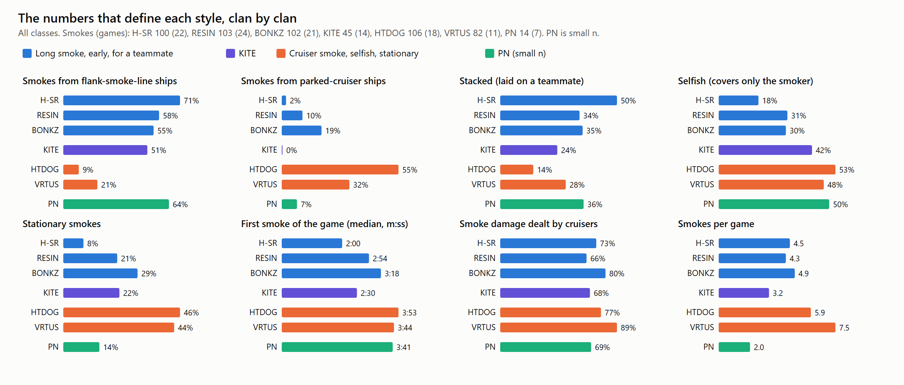
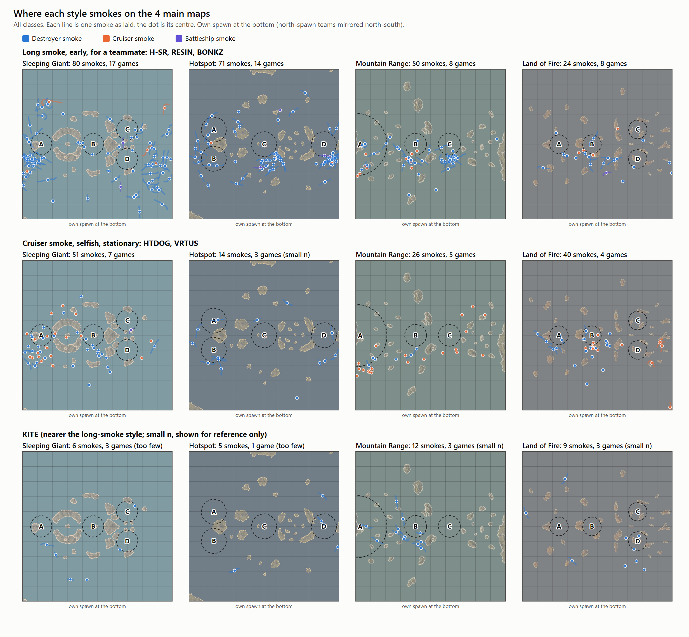

# Part D: clan smoke styles

Batch `output/20261117-122135` (1,547 smokes, 171 games). All classes unless a line says destroyer. Everything here is association: it describes what clans do and where, not what makes a clan win.

## Conclusions

1. **The two styles hold up, as two ends of one scale.** H-SR, RESIN and BONKZ (305 smokes, 67 games) lay 61% of their smoke from flank-smoke-line destroyers, 40% stacked on a teammate, 27% selfish, 20% stationary, first smoke at 2:43. HTDOG and VRTUS (188 smokes, 29 games) lay 45% from parked-smoke cruisers (Svea, Jinan), 20% stacked, 51% selfish, 45% stationary, first smoke at 3:50. Every one of those gaps has a 95% interval clear of zero.
2. **H-SR is the far end, and KITE is not in the middle.** H-SR: 71% flank smoke lines, 50% stacked, 18% selfish, 8% stationary, first smoke at 2:00 (n 100). KITE (n 45) measures nearer the long-smoke style: 96% destroyer smoke, no parked cruiser smoke, first smoke at 2:30. Only its selfish share (42%) looks like the cruiser-smoke style. BONKZ is the long-smoke clan that leans furthest the other way (19% parked cruiser smoke, 29% stationary).
3. **Both styles bring the same number of destroyers; the difference is cruisers that carry smoke.** Destroyers per game 3.3 against 3.3. Cruisers carrying smoke per game 0.3 against 1.2 (gap -1.2 to -0.6 *). The cruiser-smoke style also smokes more often: 6.5 smokes per game against 4.6.
4. **Cruisers do most of the shooting from smoke in both styles; what changes is who lays it.** Cruisers deal 73% of concealed smoke damage in the long-smoke style and 82% in the cruiser-smoke style. The smoker itself deals 23% against 65% (gap -54 to -28 * points). In one style a destroyer lays smoke for a cruiser; in the other the cruiser lays its own.
5. **A second destroyer is forward of the smoke more often in the long-smoke style, but the gap is not settled.** When a destroyer smokes, another allied destroyer is ahead of the smoke and within 10 km in 29% of cases for the long-smoke style (n 252; H-SR 36%, n 89), 18% for the cruiser-smoke style (n 92) and 18% for the Rest (n 687). Long minus cruiser: -1 to +22 points; long minus Rest: +3 to +18 *. In the first 5 minutes it is 38% (n 73) against 15% (n 20), gap +8 to +40 *.
6. **On the maps, the styles differ more in what they lay than in where.** Both smoke mostly in their own half. The clear location difference is Sleeping Giant (both flanks against west and centre); on Mountain Range the class of the smoker flips; on Land of Fire both use the middle but one parks there. See the captions.

## Style definition (all classes)

|  | Long smoke style | H-SR | RESIN | BONKZ | KITE | Cruiser smoke style | HTDOG | VRTUS | Gap, long minus cruiser (95%) |
|---|---|---|---|---|---|---|---|---|---|
| Smokes (games) | 305 (67) | 100 (22) | 103 (24) | 102 (21) | 45 (14) | 188 (29) | 106 (18) | 82 (11) |  |
| Smokes from flank-smoke-line ships | 61% | 71% | 58% | 55% | 51% | 14% | 9% | 21% | +34 to +57 * |
| Smokes from parked-cruiser-smoke ships | 10% | 2% | 10% | 19% | 0% | 45% | 55% | 32% | -48 to -23 * |
| Smokes from cap-sitter ships | 20% | 18% | 26% | 17% | 31% | 31% | 32% | 30% | -21 to -0 * |
| Stacked (laid on a teammate) | 40% | 50% | 34% | 35% | 24% | 20% | 14% | 28% | +9 to +29 * |
| Selfish (covers only the smoker) | 27% | 18% | 31% | 30% | 42% | 51% | 53% | 48% | -36 to -12 * |
| Stationary | 20% | 8% | 21% | 29% | 22% | 45% | 46% | 44% | -37 to -13 * |
| First smoke of the game (median) | 2:43 | 2:00 | 2:54 | 3:18 | 2:30 | 3:50 | 3:53 | 3:44 | -94 to -37 * s |
| Smoke damage dealt by cruisers | 73% | 73% | 66% | 80% | 68% | 82% | 77% | 89% | -18 to -1 * |
| Smokes per game | 4.6 | 4.5 | 4.3 | 4.9 | 3.2 | 6.5 | 5.9 | 7.5 | -3.3 to -0.6 * |

Rest of the field for scale (1009 smokes): 32% flank smoke lines, 12% parked cruiser, 17% moving exhaust, 23% stacked, 45% selfish, 27% stationary, first smoke 3:18, 4.3 smokes per game.

## Supporting cast

|  | Long smoke style | H-SR | RESIN | BONKZ | KITE | Cruiser smoke style | HTDOG | VRTUS | Gap, long minus cruiser (95%) |
|---|---|---|---|---|---|---|---|---|---|
| Destroyers per game | 3.3 | 3.5 | 3.3 | 3.1 | 2.9 | 3.3 | 3.5 | 2.9 | -0.2 to +0.3 |
| Ships carrying smoke per game | 2.2 | 2.0 | 2.2 | 2.3 | 1.7 | 2.8 | 2.5 | 3.2 | -1.0 to -0.1 * |
| Cruisers carrying smoke per game | 0.3 | 0.1 | 0.3 | 0.6 | 0.1 | 1.2 | 1.3 | 1.1 | -1.2 to -0.6 * |
| Destroyer smokes (n) | 252 | 89 | 87 | 76 | 43 | 92 | 46 | 46 |  |
| ... with a second destroyer forward within 10 km | 29% | 36% | 23% | 28% | 26% | 18% | 22% | 15% | -1 to +22 |
| ... same, first 5 minutes only (n) | 38% (73) | 47% (30) | 29% (24) | 37% (19) | 30% (10) | 15% (20) | 10% (10) | 20% (10) | +8 to +40 * |
| ... with any other allied destroyer on the map | 61% | 57% | 68% | 57% | 56% | 52% | 67% | 37% |  |

The batch records ship positions only at the moment each smoke was fully laid, so "forward" is one snapshot per smoke. Spotting cannot be attributed from the batch; a second destroyer forward of the smoke is the stand-in for "someone is spotting for it". Forward means toward the enemy spawn relative to the smoke centre. Not every destroyer carries smoke: the long-smoke style runs 1.6 destroyers per game without it, the cruiser-smoke style 1.8.

## Where each style smokes (4 main maps)

Own spawn at the bottom; north-spawn teams are mirrored north-south. West, middle and east are thirds of the map width. Gaps are long-smoke minus cruiser-smoke with 95% intervals (games resampled); a star means the interval is clear of zero.

- **Sleeping Giant.** The long-smoke style works both flanks (39% of smokes in the west third, 46% in the east third; 80 smokes, 17 games); the cruiser-smoke style stays west and centre (59% west, 33% middle, 8% east; 51 smokes, 7 games; east-third gap +25 to +51 * points) and parks more (41% stationary against 14%; gap -48 to -6 *).
- **Hotspot.** Not enough to separate the styles: the cruiser-smoke clans have 14 smokes in 3 games here (small n), and all 14 are destroyer smokes; they left the smoke cruisers out on this map. The long-smoke style (71 smokes, 14 games, 86% destroyer) uses the east edge most (column 10, rows F and G: 21 of 71).
- **Mountain Range.** Who smokes flips: 74% destroyer smoke for the long-smoke style (50 smokes, 8 games) against 23% for the cruiser-smoke style (26 smokes, 5 games; gap +8 to +91 * points). The long-smoke style smokes the middle third (64%); the cruiser-smoke style spreads west (54% west, 19% middle; middle gap +27 to +70 *).
- **Land of Fire.** Same place, different smoke: both styles smoke the middle around cap B (15 of 24 and 28 of 40 smokes). The cruiser-smoke style parks there (60% stationary against 17%, gap -59 to -24 * points; 16 of 40 smokes in cell F5) and half of it is cruiser smoke (48% against 21%). 24 smokes in 8 games against 40 in 4.
- KITE has 6, 5, 12, 9 smokes on these maps: too few for a map reading; drawn for reference only.

## PN call-out (small n)

PN (3-4, 14 smokes in 7 games, 10 destroyer) sits nearest the long-smoke style (distance 2.9 against 5.3 to the cruiser-smoke style): 64% flank smoke lines, 36% stacked. It differs from that style by smoking little and late (2.0 smokes per game, first smoke 3:41), by a 50% selfish share, and by 21% moving exhaust smoke. With 14 smokes each of these shares moves 7 points per smoke.

## Rest clans with 7 or more games

| Clan | W-L | Smokes | Nearest style | Flank lines | Parked cruiser | Moving exhaust | Selfish |
|---|---|---|---|---|---|---|---|
| EPOXY | 9-8 | 82 | long smoke | 43% | 13% | 2% | 22% |
| MZY | 12-7 | 50 | long smoke | 56% | 0% | 14% | 32% |
| BONKY | 3-4 | 36 | long smoke | 50% | 17% | 14% | 36% |
| REEEE | 8-5 | 52 | long smoke | 52% | 0% | 15% | 44% |
| HFANS | 10-7 | 110 | long smoke | 30% | 6% | 11% | 42% |
| PFANS | 5-7 | 24 | long smoke | 50% | 12% | 12% | 42% |
| NGA | 0-7 | 28 | long smoke | 39% | 0% | 39% | 43% |
| KSC | 6-5 | 63 | long smoke | 46% | 17% | 2% | 43% |
| 5D | 3-7 | 37 | between | 24% | 0% | 51% | 43% |
| RSR | 0-7 | 26 | between | 42% | 31% | 0% | 50% |
| -BN- | 6-8 | 91 | between | 40% | 22% | 4% | 42% |
| UYSC | 1-6 | 36 | between | 17% | 8% | 31% | 58% |
| MACHX | 8-6 | 82 | between | 21% | 17% | 20% | 56% |
| KSE | 2-5 | 20 | cruiser smoke | 0% | 0% | 25% | 50% |
| KITED | 7-7 | 63 | cruiser smoke | 8% | 13% | 48% | 65% |
| SCCC2 | 3-4 | 48 | cruiser smoke | 6% | 27% | 2% | 58% |
| MACH | 1-6 | 29 | cruiser smoke | 0% | 21% | 10% | 69% |

8 sit nearer the long-smoke style, 4 nearer the cruiser-smoke style, 5 between (the two distances within 15% of each other). Several Rest clans fit neither style well because they lean on moving exhaust smoke (Italian ships), which neither Top 6 style uses much.

## Method and cautions

- Styles were checked by distance on 9 numbers per clan (4 ship-habit shares, stacked, selfish, stationary, first-smoke time, cruiser share of smoke damage), each scaled across the 24 clans with 7+ games. Distances: HTDOG to VRTUS 2.55, H-SR to RESIN 2.8, RESIN to BONKZ 1.75, RESIN to KITE 1.68, H-SR to HTDOG 8.06, BONKZ to VRTUS 3.13, BONKZ to H-SR 3.55.
- Smoke habit is a property of the ship, so the habit shares mostly restate which ships a clan picked. Stacked, selfish and stationary come from the batch's own labels for each smoke.
- Intervals: 95%, 1000 resamples of games within each style (a style has only 2 or 3 clans, so clans cannot be resampled). They show how much the numbers move game to game, not how a different set of clans would look.
- The cruiser-smoke style is 2 clans and 29 games. Map rows are thin: 14 smokes on Hotspot, 26 on Mountain Range.
- Clans pick ships per map and per opponent, so some of the map differences are line-up choices on that map, not a fixed habit.
